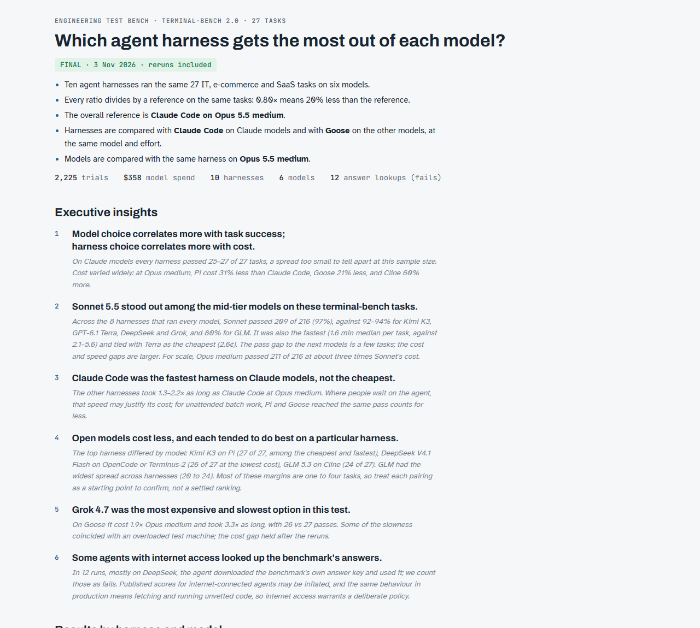
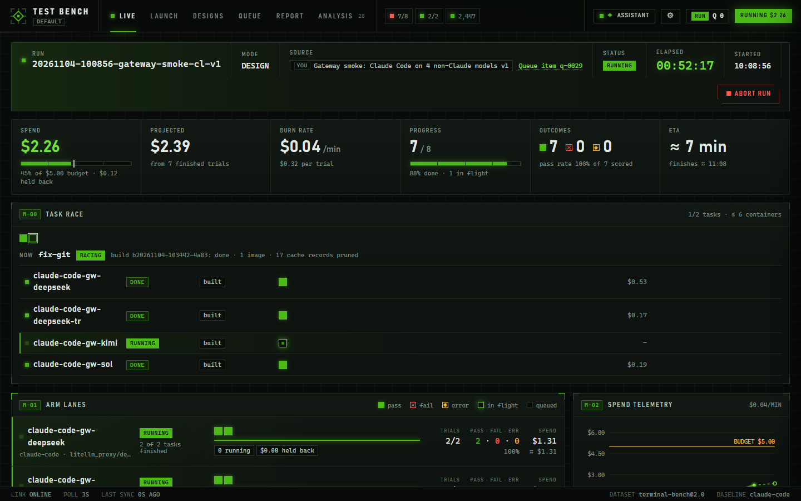
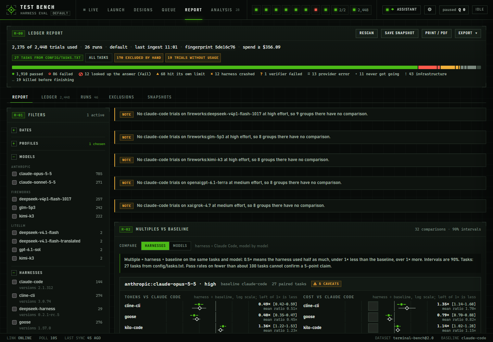

# Engineering Test Bench

**Which AI coding agent (harness) gets the most out of each model, and at what cost?**

The bench runs eleven agent harnesses (Droid added 13 Nov 2026) on seven models over the same 27 real-world IT, e-commerce and SaaS tasks
(terminal-bench 2.0), and compares task success, cost and speed on the same tasks.

**[Read the report →](https://leon3536.github.io/eng-test-bench/report.html)** (interactive; also in the repo: [docs/report.html](docs/report.html)) · [Full tables](docs/results.md) · [Guide](docs/guide.md)

[](https://leon3536.github.io/eng-test-bench/report.html)

## What we found (3 Nov 2026; gateway 6 Nov; Droid 13 Nov 2026)

1. **Model choice correlates more with task success; harness choice correlates more with cost.**
2. **Sonnet 5.5 stood out among the mid-tier models**: it passed 97% of tasks across the 8 harnesses that ran every model in the 3 Nov results (before Droid), was the fastest, and tied with Terra as the cheapest.
3. **Claude Code was the fastest harness at Opus 5.5 medium (agent run time, task by task), not the cheapest.** At Opus low and high and on Sonnet, Goose was about as fast or faster.
4. **DeepSeek and GLM cost less than Opus 5.5 medium on every harness (for GLM on Kilo, mini-swe-agent and Droid, no difference is also possible), and each open model tended to do best on a particular harness.**
5. **Grok 4.7 was the most expensive option in this test, and the slowest on most harnesses.**
6. **Some agents with internet access looked up the benchmark's answers.** We count those as fails.
7. **Droid's handling of the agent's background processes correlated with failures on tasks that ask the agent to leave a service running.** In 17 of Droid's 20 failed trials on those tasks, the Droid program's log shows it stopping the server the task needed when it exited (Droid 1.0.0, `droid exec`); without those three tasks Droid passed as many tasks as the reference harness, or more, in 8 of 9 model columns.

**Scope and limitations.** 27 terminal-bench 2.0 tasks on Harbor 0.25.0, one attempt per task (two where a
trial was rerun). Model and harness versions and list prices are as of 3 Nov 2026 (gateway: 6 Nov 2026; Droid: 13 Nov 2026). A busy test machine slowed
some trials, so treat small timing differences with care. The results hold for these tasks and versions only.

2,225 trials, $358 in model fees (3 Nov results, 41 runs; Droid adds 243 trials and $46.23; the 6 Nov gateway experiment, $16.37, is reported separately). Every ratio divides by a reference on the same tasks: Claude Code on
Opus 5.5 medium overall, Claude Code (Claude models) or Goose (other models) when comparing harnesses, and
Opus 5.5 medium when comparing models.

### Tasks passed (of 27)

<!-- results:start -->
| Harness | Opus 5.5 low | Opus 5.5 medium | Opus 5.5 high | Sonnet 5.5 | Kimi K3 | GPT-6.1 Terra | DeepSeek V4.1 Flash | GLM 5.3 | Grok 4.7 |
|---|---|---|---|---|---|---|---|---|---|
| Claude Code | 25/27 | 27/27 | 26/27 | 25/27 | 25/27† | 26/27† | 26/27† | · | · |
| Pi | 26/27 ★ | 26/27 | 27/27 ★ | 26/27 ⭐ | 27/27 | 25/27 | 26/27 ⊘ ★ | 22/27 | 24/27 ⊘ |
| Goose | 27/27 ⭐ | 27/27 | 27/27 ★ | 26/27 ★ | 26/27 | 25/27 | 23/27 | 21/27 | 26/27 |
| OpenCode | 26/27 | 26/27 | 27/27 | 26/27 ★ | 26/27 | 25/27 | 26/27 ⊘2 ⭐ | 22/27 | 26/27 ⊘ |
| Kilo | 27/27 | 27/27 | 27/27 | 26/27 | 24/27 | 26/27 | 26/27 ⊘ | 20/27 | 22/27 |
| Cline | 26/27 | 27/27 | 27/27 | 26/27 | 26/27 | 25/27 | 25/27 | 24/27 | 26/27 ⊘ |
| Terminus-2 | 25/27 | 27/27 | 27/27 | 26/27 | 25/27 | 26/27 | 26/27 | 23/27 | 24/27 ⊘ |
| mini-swe-agent | 27/27 ★ | 26/27 | 26/27 | 26/27 ★ | 26/27 | 26/27 | 24/27 ⊘2 ★ | 20/27 | 27/27 |
| Strands | 27/27 ★ | 25/27 | 27/27 | 27/27 ★ | 24/27 | 26/27 | 24/27 ⊘ | 21/27 | 24/27 |
| Droid | 24/27 ★ | 24/27 | 25/27 | 22/27 | 26/27 | 23/27 | 25/27 ⊘ | 22/27 | 22/27 |
| DeepSeek Harness | · | · | · | · | · | · | 24/27 ⊘ ★ | · | · |

⭐ local optimum: beats both its column's reference harness and its own harness on Opus 5.5 medium.
★ beats one of the two. "Beats" means no fewer passes, cost and time within 5% or better, and at least 5% cheaper
or faster. ⊘ marks answer lookups (the agent downloaded the benchmark's own answers), counted as fails. · not run.
† Claude Code through the LiteLLM gateway, not a direct run (see the gateway section).
<!-- results:end -->

### Claude Code through a LiteLLM gateway (6 Nov 2026)

A second experiment ran Claude Code through a self-hosted LiteLLM gateway on the same 27 tasks
([details](docs/results.md#claude-code-through-a-litellm-gateway-6-nov-2026)). Ratios divide by a reference on the same tasks.

- **The Opus control stayed within one trial of direct**: 26 of 27 passed against 27 of 27, at 1.48× the direct run's cost.
- **Translating Claude Code's requests correlated with four DeepSeek timeouts**: 23 of 27 passed on the translated route (the gateway converts the requests to the provider's own API) and 26 of 27 on the native route (the provider takes them as they are).
- **Kimi K3 passed only on the pass-through route** (25 of 27); **Terra's cost was corrected from $11.41 to $2.01** using the gateway's own spend log.

### Droid (13 Nov 2026)

Factory's Droid 1.0.0 ran the same 27 tasks in all nine model columns ([details](docs/results.md#droid-13-nov-2026)).

- **The Droid program's log shows it stopping the server the task needed in 17 of Droid's 20 failed server-task trials**: on exit it stopped the background processes the agent had started through it. These three tasks accounted for 20 of Droid's 30 failed trials: `kv-store-grpc` passed 0 of 9, `hf-model-inference` 4 of 9 and `pypi-server` 3 of 9, against about 94% for the other harnesses.
- **Without those three tasks, Droid passed as many tasks as the reference harness, or more, in 8 of 9 model columns**, including 22 of 24 on GLM 5.3, more than any other harness on that model.

## How it works

- **Designs and a queue.** You describe a run (harnesses × models × tasks); the bench estimates its cost and
  queues it.
- **Task races.** Each task runs every harness at once in its own container, so all of them see the same
  conditions.
- **One ledger.** Every trial from every run lands in one database, with its outcome, tokens, cost, time and
  host load.
- **A report you can trust.** Failures on our side are rerun, provider stalls count as fails, and an automatic
  check catches agents that download the benchmark's answers.

| The runner | The report tab |
|---|---|
|  |  |

## Run it

Windows 11 with Docker Desktop and Python 3.13. Copy `.env.example` to `.env` and fill in the provider keys you use (see the [guide](docs/guide.md#keys)), then:

```powershell
powershell -ExecutionPolicy Bypass -File .\start.ps1               # the default profile
powershell -ExecutionPolicy Bypass -File .\start.ps1 -Profile dev  # cheap test models
```

The console prints a dashboard link. Everything else (designs, the queue, pre-baked images, the ledger, the
report, configuration and tests) is in the [guide](docs/guide.md).

## Credits

- [terminal-bench 2.0](https://github.com/laude-institute/terminal-bench) by laude-institute (Apache-2.0)
  supplies the tasks. Task names, and one task's instruction text, appear in the test fixtures.
- [Harbor](https://harborframework.com) is the evaluation framework that runs the agents and tasks.

## License

[MIT](LICENSE). terminal-bench and Harbor keep their own licenses.
