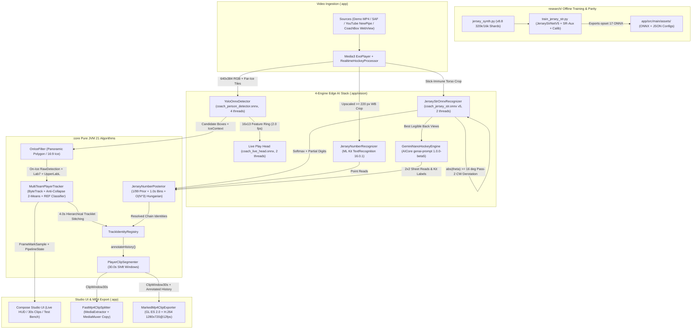
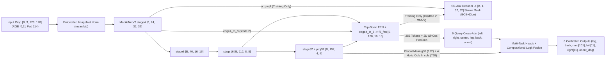
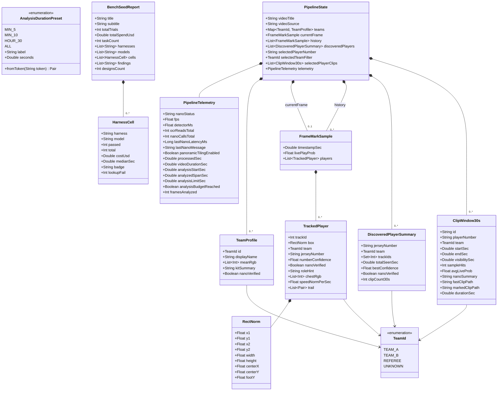
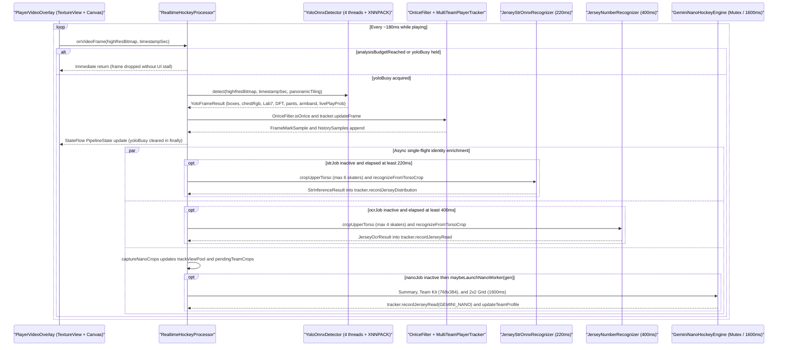
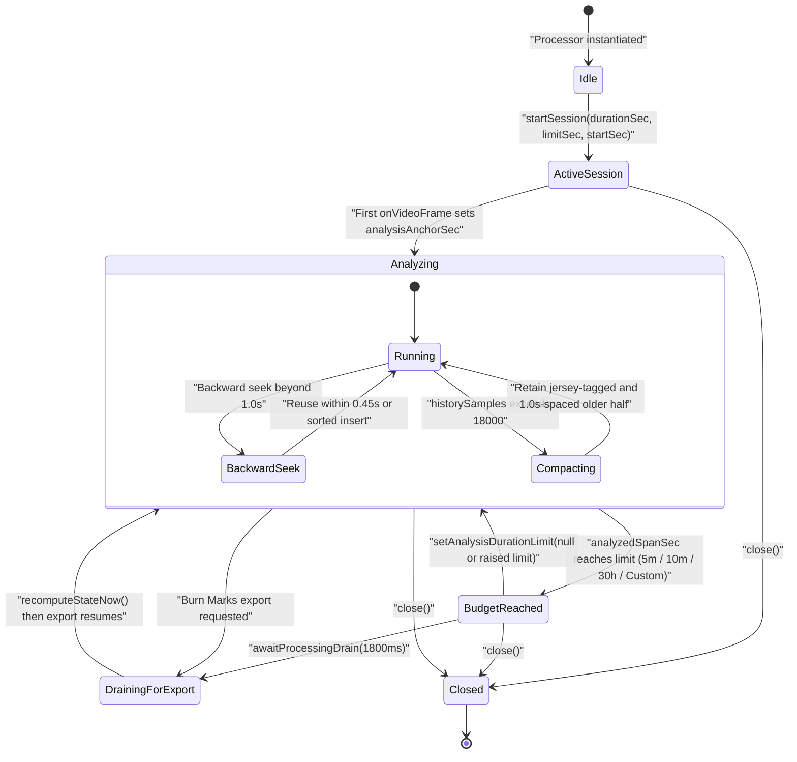

# HockeyNano Bench (com.engtestbench.hockeynano) — Android Engineering Design Specification

**Version:** `1.0.0` (`v5.1` Pipeline)  
**Baseline Code Commit:** `2a5cef3` (`2a5cef3b2c8a2253cb040de6a33c3a73cb26ec62`)  
**Application ID:** `com.engtestbench.hockeynano`  
**Target Platform:** `Android 12+ (minSdk 31, compileSdk 35, targetSdk 35), JVM 21`  
**Verified Device:** `Google Pixel 11 Pro / Tensor G6 (Android 17, AICore + XNNPACK)`

---

## Table of Contents

- [1. Executive Summary, Product Goals & Design Philosophy](#1-executive-summary-product-goals--design-philosophy)
  - [1.1 Problem Statement & Product Vision](#11-problem-statement--product-vision)
  - [1.2 Four Core Product Pillars](#12-four-core-product-pillars)
  - [1.3 Design Invariants & Explicit Non-Goals](#13-design-invariants--explicit-non-goals)
- [2. System Architecture & Multi-Module Gradle Layout](#2-system-architecture--multi-module-gradle-layout)
  - [2.1 Multi-Module Separation (`:core` vs. `:app` vs. `research/`)](#21-multi-module-separation-core-vs-app-vs-research)
  - [2.2 End-to-End System Architecture (`flowchart TD`)](#22-end-to-end-system-architecture-flowchart-td)
  - [2.3 Annotated Directory Tree](#23-annotated-directory-tree)
  - [2.4 Gradle Build & Dependency Specification](#24-gradle-build--dependency-specification)
- [3. On-Device AI & Multimodal Model Suite (4-Engine Hybrid Stack)](#3-on-device-ai--multimodal-model-suite-4-engine-hybrid-stack)
  - [3.1 Model Inventory, Tensor Signatures & Measured Latencies](#31-model-inventory-tensor-signatures--measured-latencies)
  - [3.2 `coach_live_head.onnx` Temporal Feature Contract](#32-coach_live_headonnx-temporal-feature-contract)
  - [3.3 `JerseyStrNetV5` Architecture, `SR-Aux` Supervision & Temperature Calibration](#33-jerseystrnetv5-architecture-sr-aux-supervision--temperature-calibration)
  - [3.4 `v8.8` Synthetic Training Pipeline & Validation Gates](#34-v88-synthetic-training-pipeline--validation-gates)
  - [3.5 Rationale for the 4-Engine Hybrid Architecture](#35-rationale-for-the-4-engine-hybrid-architecture)
- [4. `:core` Computer Vision, Multi-Team Tracking & Roster-Free Identity Algorithms](#4-core-computer-vision-multi-team-tracking--roster-free-identity-algorithms)
  - [4.1 `OnIceFilter` — Panoramic Polygon & `16:9` White-Balanced Ice Gating](#41-onicefilter--panoramic-polygon--169-white-balanced-ice-gating)
  - [4.2 `KitLabFeatures` — Order-Free 7D CIELAB Kit Geometry & Dark-Crest Immunity](#42-kitlabfeatures--order-free-7d-cielab-kit-geometry--dark-crest-immunity)
  - [4.3 `JerseyCropGeometry` — Stick-Immune Crops, Bicubic Upsampling & Rotation Convention](#43-jerseycropgeometry--stick-immune-crops-bicubic-upsampling--rotation-convention)
  - [4.4 `MultiTeamPlayerTracker` — Motion Tracking, Anti-Collapse Clustering, `[REF]` Cues & 2-Stage Stitching](#44-multiteamplayertracker--motion-tracking-anti-collapse-clustering-ref-cues--2-stage-stitching)
  - [4.5 `JerseyNumberPosterior` — Roster-Free Bayesian Fusion & Hungarian Exclusivity](#45-jerseynumberposterior--roster-free-bayesian-fusion--hungarian-exclusivity)
  - [4.6 `PlayerClipSegmenter` — `O(hits)` `30.0s` Shift Windowing](#46-playerclipsegmenter--ohits-300s-shift-windowing)
- [5. Domain Data Models & State Contracts](#5-domain-data-models--state-contracts)
  - [5.1 Domain & Identity Class Diagram (`classDiagram`)](#51-domain--identity-class-diagram-classdiagram)
  - [5.2 Core State & Analytics Model Contracts](#52-core-state--analytics-model-contracts)
  - [5.3 Internal Tracking & Posterior Bridge Contracts](#53-internal-tracking--posterior-bridge-contracts)
- [6. Real-Time Concurrency, Scheduling & Backpressure (`RealtimeHockeyProcessor`)](#6-real-time-concurrency-scheduling--backpressure-realtimehockeyprocessor)
  - [6.1 Threading, Locks & Single-Flight Gates](#61-threading-locks--single-flight-gates)
  - [6.2 Live Frame Loop Sequence](#62-live-frame-loop-sequence)
  - [6.3 Pause / Step-Hold Posterior Inflation Guard (`4x4` Luma Signature Anchoring)](#63-pause--step-hold-posterior-inflation-guard-4x4-luma-signature-anchoring)
  - [6.4 Processor Lifecycle, Duration Budgets & Pre-Export Drain](#64-processor-lifecycle-duration-budgets--pre-export-drain)
- [7. `:app` Vision & Multimodal Inference Bridges](#7-app-vision--multimodal-inference-bridges)
  - [7.1 `YoloOnnxDetector` (YOLOv8n + Causal Live Head + Multi-Scale Cue Extraction)](#71-yoloonnxdetector-yolov8n--causal-live-head--multi-scale-cue-extraction)
  - [7.2 `TorsoCropHelper` & `JerseyStrOnnxRecognizer` (`v5` STR + Upright Derotation)](#72-torsocrophelper--jerseystronnxrecognizer-v5-str--upright-derotation)
  - [7.3 `JerseyNumberRecognizer` (Dual-Pass ML Kit OCR)](#73-jerseynumberrecognizer-dual-pass-ml-kit-ocr)
  - [7.4 `GeminiNanoHockeyEngine` (Multimodal AICore VLM)](#74-gemininanohockeyengine-multimodal-aicore-vlm)
- [8. Multi-Source Video Ingestion Pipeline](#8-multi-source-video-ingestion-pipeline)
  - [8.1 `YouTubeHockeyResolver` Details](#81-youtubehockeyresolver-details)
  - [8.2 `CoachBoxWebDialog` Multi-Host Connector](#82-coachboxwebdialog-multi-host-connector)
- [9. 30-Second Shift Clip Splitting & Hardware-Accelerated Marked MP4 Export](#9-30-second-shift-clip-splitting--hardware-accelerated-marked-mp4-export)
  - [9.1 `FastMp4ClipSplitter` (Zero-Reencode Stream Copy)](#91-fastmp4clipsplitter-zero-reencode-stream-copy)
  - [9.2 `MarkedMp4ClipExporter` (`1280x720 @ 12 fps, 4 Mbps` H.264 Burn-In)](#92-markedmp4clipexporter-1280x720--12-fps-4-mbps-h264-burn-in)
  - [9.3 `ClipLibraryRepository` Persistence & Android Sharing](#93-cliplibraryrepository-persistence--android-sharing)
- [10. Jetpack Compose UI/UX Architecture & Headless ADB Automation](#10-jetpack-compose-uiux-architecture--headless-adb-automation)
  - [10.1 Material 3 Dark Theme & 3-Tab Studio Shell](#101-material-3-dark-theme--3-tab-studio-shell)
  - [10.2 Headless ADB Automation Contract (`MainActivity.parseAutomationIntent`)](#102-headless-adb-automation-contract-mainactivityparseautomationintent)
- [11. Verification Suite & Live Pixel 11 Pro vs. Cloud Benchmarks](#11-verification-suite--live-pixel-11-pro-vs-cloud-benchmarks)
  - [11.1 Deterministic `:core` Unit Verification Suite (`37/37` Passing)](#111-deterministic-core-unit-verification-suite-3737-passing)
  - [11.2 `v5` Synthetic Telephoto STR Gate (`coach_jersey_str.json`)](#112-v5-synthetic-telephoto-str-gate-coach_jersey_strjson)
  - [11.3 Live Pixel 11 Pro (`66140DLKX003E1`) `v5.1` vs. `v5` / `R3` vs. Cloud (`coach.leonxzhao.com`)](#113-live-pixel-11-pro-66140dlkx003e1-v51-vs-v5--r3-vs-cloud-coachleonxzhaocom)
  - [11.4 Pixel 11 Pro (`v5.1`) Runtime Latency, FPS, Exports & APK Footprint](#114-pixel-11-pro-v51-runtime-latency-fps-exports--apk-footprint)
- [12. Build, Developer Quickstart, Privacy Architecture & Peer-Review Trade-Offs](#12-build-developer-quickstart-privacy-architecture--peer-review-trade-offs)
  - [12.1 Prerequisites & Toolchain](#121-prerequisites--toolchain)
  - [12.2 Gradle Build, Test & Device Installation Commands](#122-gradle-build-test--device-installation-commands)
  - [12.3 Headless ADB Benchmark Recipes](#123-headless-adb-benchmark-recipes)
  - [12.4 Privacy Architecture & Permissions (`AndroidManifest.xml`)](#124-privacy-architecture--permissions-androidmanifestxml)
  - [12.5 Honest Engineering Trade-Offs & Future Roadmap (Peer Review)](#125-honest-engineering-trade-offs--future-roadmap-peer-review)
- [Appendix: Reviewer Guide & Key Files Quick-Index](#appendix-reviewer-guide--key-files-quick-index)
  - [Stage 1 — Pure-JVM Domain Contracts & CV/Tracking Algorithms (`:core`)](#stage-1--pure-jvm-domain-contracts--cvtracking-algorithms-core)
  - [Stage 2 — Android Vision Pipeline, Media Export & Compose Studio (`:app`)](#stage-2--android-vision-pipeline-media-export--compose-studio-app)
  - [Stage 3 — Offline Training, Literature Synthesis & Parity Benchmarks (`research/`)](#stage-3--offline-training-literature-synthesis--parity-benchmarks-research)

---

## 1. Executive Summary, Product Goals & Design Philosophy

### 1.1 Problem Statement & Product Vision

Youth and amateur ice hockey video scouting traditionally suffers from two structural bottlenecks: (1) cloud analytics platforms (such as `coach.leonxzhao.com` and `coachbox.tvbdhockey.com`) require manual per-arena rink polygon calibration and pre-entered game-sheet player rosters before delivering tracking or jersey identification, and (2) raw broadcast or arena-camera recordings are `60–120` minutes long, forcing coaches and parents to scrub manually for individual skater shifts. When an opponent roster is unavailable or a game lacks rink calibration, cloud pipelines either stall at `0%` (`"Not analyzed yet · calibrate the rink"`) or collapse in jersey ID recall (`0.3%` in unrostered Game 3).

**HockeyNano Bench** solves this entirely on-device as a **100% roster-free, calibration-free edge AI hockey shift scout and 30-second clip splitter** for Android (`com.engtestbench.hockeynano`). Given any raw local MP4, bundled demo clip, YouTube hockey link, or authenticated CoachBox video stream, the app detects on-ice skaters and officials, separates the two teams and referees in perceptual color space, reads occluded and tilted jersey numbers using a calibrated hybrid vision + multimodal LLM pipeline, segments every identified skater's shifts into non-overlapping `30.0s` windows, and exports both zero-reencode fast MP4 splits and hardware-accelerated marked MP4 highlights.

### 1.2 Four Core Product Pillars

1. **Zero-Cloud Inference & Zero Manual Setup:** Every inference engine—person detection, causal live-play classification, jersey scene text recognition (STR), Latin OCR, and multimodal VLM reasoning—executes locally on the handset via ONNX Runtime (`1.22.0` + XNNPACK), ML Kit (`16.0.1`), and Pixel AICore Gemini Nano (`com.google.mlkit:genai-prompt:1.0.0-beta5`). No video frames leave the device for vision processing, and no manual rink calibration is required across panoramic `~2.25:1` or `16:9` zoomed feeds.
2. **100% Roster-Free Uniform Identity (`1/99` Prior):** Both synthetic STR training ([jersey_synth.py](../research/jersey_synth.py)) and temporal tracklet number fusion ([JerseyNumberPosterior.kt](core/src/main/kotlin/com/engtestbench/hockeynano/core/tracking/JerseyNumberPosterior.kt)) enforce a strictly uniform prior (`UNIFORM_PRIOR = 1.0 / 99.0` over `"1".."99"` in `:core`, uniform `1..99` + `"00"` in ONNX training) with zero game-sheet priors, zero team-specific priors, and zero test-frame leakage.
3. **Deterministic Pure-JVM `:core` Engine:** Spatial ice filtering, CIELAB kit clustering, stick-immune crop geometry, ByteTrack-style motion tracking, Bayesian posterior fusion, `O(N^3)` Hungarian co-occurrence assignment, and `O(hits)` `30.0s` shift segmentation reside in [`:core`](core/build.gradle.kts) (`Java 21`, zero `android.*` imports). This isolates mathematical correctness from Android lifecycle/UI code and enables fast headless JUnit 5 verification on desktop JVM.
4. **Hybrid Specialist CNN + Asynchronous Edge VLM:** Real-time frame tracking (~`3.1–3.5 fps` on Pixel 11 Pro) is decoupled from high-latency VLM calls (`~436 ms` per contact sheet, `~686 ms` per team-naming call) via non-blocking frame gates and multi-source log-posterior fusion weighting `ONNX_STR` (`1.6f`), `GEMINI_NANO` (`1.6f`), and `MLKIT_OCR` (`1.0f`) with `1.0s` temporal bin deduplication.

### 1.3 Design Invariants & Explicit Non-Goals

| Category | Specification |
|---|---|
| **Invariant: Zero Test Leakage** | Synthetic STR shards (`v8.8`, `320k` train / `16k` val) never read or import real evaluation videos; all real benchmark clips are strictly held out. |
| **Invariant: Canonical Team Ordering** | Teams always map to `TEAM_A` (darker kit by `kitEffectiveLightness`) and `TEAM_B` (lighter kit), with `REFEREE` isolated into a separate cluster prior to 2-means centroid estimation. |
| **Invariant: XNNPACK-Safe Graphs** | All bundled ONNX models target `opset 17` and exclude `GridSample` or unsupported ops (`coach_jersey_str.onnx` uses `28` verified XNNPACK-safe op types). |
| **Invariant: Frame-Hold Immunity** | `JerseyNumberPosterior` deduplicates repeated non-Nano reads within each `1.0s` `(bin, channel)` bucket (`0.15x` marginal weight) so paused or step-held video frames cannot artificially inflate posterior confidence. |
| **Invariant: Retroactive Identity Settlement** | `MultiTeamPlayerTracker.annotateHistory()` propagates stitched chain teams and Hungarian-resolved jersey numbers backward across all historical `FrameMarkSample`s before clip splitting or marked MP4 rendering. |
| **Non-Goal: Roster-Assisted Matching** | The pipeline intentionally refuses pre-loaded player lists, name lookups, or jersey-number priors, trading distant sub-`20 px` optical recall for robustness on unrostered games. |
| **Non-Goal: Cloud GPU Offloading** | Network access (`INTERNET` permission) is restricted to video source acquisition (YouTube/CoachBox) and optional AICore asset download; zero frames or telemetry are sent to inference servers. |
| **Non-Goal: Puck/Event Tracking & Cross-Game Re-ID** | Tracking targets skaters and officials within a single video session (`reset()` clears state per video); puck coordinates, shot/pass events, and cross-game embeddings are out of scope. |

---

## 2. System Architecture & Multi-Module Gradle Layout

### 2.1 Multi-Module Separation (`:core` vs. `:app` vs. `research/`)

The repository under `android/` splits into two Gradle modules alongside an offline `research/` training and parity-evaluation suite:

- **`:core` (Pure Kotlin/JVM 21):** Stateless domain models and deterministic CV/tracking/clip-segmentation algorithms. Depends only on `kotlinx-coroutines-core` and `kotlinx-serialization-json`. Tested on the JVM via JUnit 5 (`useJUnitPlatform()`).
- **`:app` (Android Application SDK 35 / minSdk 31):** Handles hardware media decoding (`Media3 ExoPlayer` + `MediaExtractor`/`MediaMetadataRetriever`), video ingestion (`SAF`, `NewPipeExtractor`, `CoachBoxWebDialog`), ORT/MLKit/AICore execution bridges (`YoloOnnxDetector`, `JerseyStrOnnxRecognizer`, `JerseyNumberRecognizer`, `GeminiNanoHockeyEngine`), real-time scheduling (`RealtimeHockeyProcessor`), OpenGL ES 2.0 + `MediaCodec` marked export (`MarkedMp4ClipExporter`), fast keyframe splitting (`FastMp4ClipSplitter`), and Jetpack Compose Material3 screens.
- **`research/` (Python 3 + PyTorch + OpenCV):** Houses [jersey_synth.py](../research/jersey_synth.py) (`v8.8` synthetic telephoto generator), [train_jersey_str.py](../research/train_jersey_str.py) (`JerseyStrNetV5` trainer, temperature calibrator, and ONNX exporter), and Python parity evaluation harnesses ([coachbox_local_eval.py](../research/coachbox_local_eval.py), [leonxzhao_5games_eval.py](../research/leonxzhao_5games_eval.py)) that mirror `:core`/`:app` thresholds offline.

### 2.2 End-to-End System Architecture (`flowchart TD`)



### 2.3 Annotated Directory Tree

```text
android/
├── settings.gradle.kts                  # Root project "HockeyNanoBench", includes :core and :app
├── build.gradle.kts                     # AGP 8.7.2, Kotlin 2.3.21, Compose & Serialization plugins
├── gradle.properties                    # -Xmx2048m heap, AndroidX + official Kotlin style (uses standard JAVA_HOME / JDK 21 toolchain)
├── core/
│   ├── build.gradle.kts                 # Pure JVM 21 module; coroutines, serialization, JUnit 5.11.0
│   └── src/
│       ├── main/kotlin/com/engtestbench/hockeynano/core/
│       │   ├── model/HockeyModels.kt            # TeamId, RectNorm, TrackedPlayer, PipelineState, etc.
│       │   ├── bench/BenchReportModels.kt       # HarnessCell & BenchSeedReport analytics schema
│       │   ├── tracking/OnIceFilter.kt          # Panoramic polygon & 16:9 WB CIELAB ice gating
│       │   ├── tracking/KitLabFeatures.kt       # D65 sRGB->CIELAB, 7D kit summary, Huberized distances
│       │   ├── tracking/JerseyCropGeometry.kt   # Stick-immune crop bounds, bicubic+unsharp, CW/CCW math
│       │   ├── tracking/MultiTeamPlayerTracker.kt # Motion tracker, 2-means, REF cues, 4s stitching
│       │   ├── tracking/JerseyNumberPosterior.kt  # 1/99 Bayes, confusion matrix, Hungarian solver
│       │   └── clip/PlayerClipSegmenter.kt      # O(hits) sliding/merged 30.0s shift windowing
│       └── test/kotlin/com/engtestbench/hockeynano/core/
│           ├── HockeyModelsAndBenchSerializationTest.kt
│           ├── MultiTeamPlayerTrackerTest.kt
│           ├── MultiTeamPlayerTrackerSotaTest.kt
│           ├── OnIceFilterTest.kt
│           └── PlayerClipSegmenterTest.kt
└── app/
    ├── build.gradle.kts                 # compileSdk 35, minSdk 31, ORT 1.22.0, Media3, MLKit, NewPipe
    └── src/main/
        ├── AndroidManifest.xml          # Permissions, largeHeap=true, AICore ENABLE_GENAI meta-data
        ├── assets/
        │   ├── coach_person_detector.onnx       # 12,784,256 B YOLOv8n + NMS person detector
        │   ├── coach_live_head.onnx             # 170,237 B causal 16-frame live-play head
        │   ├── coach_live.json                  # Live-head 13-feature metadata & 0.57243 threshold
        │   ├── coach_jersey_str.onnx            # 12,487,366 B v5 JerseyStrNetV5 STR+Orientation
        │   ├── coach_jersey_str.json            # v5 ONNX I/O metadata, calibration, val metrics
        │   └── bench_summary_seed.json          # 21,130 B bundled 2,468-trial Test Bench seed report
        ├── res/
        │   ├── raw/hockey_sample_30s.mp4        # Bundled 30s demo clip
        │   └── values/strings.xml               # App name ("HockeyNano Bench")
        └── java/com/engtestbench/hockeynano/
            ├── MainActivity.kt                  # Entry Activity, ViewModel, ADB automation CLI
            ├── data/                            # BenchSeedRepository, ClipLibraryRepository
            ├── vision/                          # YoloOnnxDetector, JerseyStrOnnxRecognizer,
            │                                    # JerseyNumberRecognizer, GeminiNanoHockeyEngine,
            │                                    # TorsoCropHelper, RealtimeHockeyProcessor
            ├── video/                           # FastMp4ClipSplitter, MarkedMp4ClipExporter
            ├── youtube/YouTubeHockeyResolver.kt # NewPipeExtractor + OkHttp muxing resolver
            └── ui/                              # Compose Theme, Studio/Clips/Bench screens & overlays

../research/
├── jersey_synth.py                      # v8.8 100% roster-free synthetic crop & SR mask generator
├── train_jersey_str.py                  # JerseyStrNetV5 training, calibration & opset-17 export
├── LITERATURE_AND_ABLATIONS.md          # Literature synthesis & Round 1–4 ablation record
├── coachbox_local_eval.py               # Offline CoachBox & TVI Iceland parity evaluation harness
├── leonxzhao_5games_eval.py             # 5-game coach.leonxzhao.com offline parity evaluator
├── local_validation_report.json         # Local ablation & regression JSON report
└── leonxzhao_5games_report.json         # 5-game + CoachBox + native clip report
```

### 2.4 Gradle Build & Dependency Specification

| Component | Module / File | Exact Version / Configuration | Role |
|---|---|---|---|
| **Gradle Wrapper** | [gradle-wrapper.properties](gradle/wrapper/gradle-wrapper.properties) | `8.10.2` (`-Xmx2048m` in [gradle.properties](gradle.properties)) | Multi-module JVM/Android build orchestration |
| **Build Toolchain** | [build.gradle.kts](build.gradle.kts) | AGP `8.7.2`, Kotlin `2.3.21`, Java `21` | `kotlin.jvm`, `kotlin.android`, `kotlin.plugin.compose`, `kotlin.plugin.serialization` |
| **Repositories** | [settings.gradle.kts](settings.gradle.kts) | `google()`, `mavenCentral()`, `https://jitpack.io` | `FAIL_ON_PROJECT_REPOS` enforced |
| **Coroutines & JSON** | [core/build.gradle.kts](core/build.gradle.kts), [app/build.gradle.kts](app/build.gradle.kts) | `kotlinx-coroutines-{core,android}:1.8.1`, `kotlinx-serialization-json:1.7.3` | Async frame pipelines & deterministic JSON contracts |
| **Core Unit Testing** | [core/build.gradle.kts](core/build.gradle.kts) | `kotlin("test")`, `junit-jupiter:5.11.0`, `kotlinx-coroutines-test:1.8.1` | Headless JUnit 5 verification (`useJUnitPlatform()`) |
| **ONNX Runtime** | [app/build.gradle.kts](app/build.gradle.kts) | `com.microsoft.onnxruntime:onnxruntime-android:1.22.0` | CPU + XNNPACK execution (`noCompress += ["onnx", "tflite"]`) |
| **ML Kit GenAI Prompt** | [app/build.gradle.kts](app/build.gradle.kts) | `com.google.mlkit:genai-prompt:1.0.0-beta5` | On-device Pixel AICore Gemini Nano (`Generation.getClient()`) |
| **ML Kit Text Rec v2** | [app/build.gradle.kts](app/build.gradle.kts) | `com.google.mlkit:text-recognition:16.0.1` | Bundled Latin OCR fallback/corroboration |
| **Jetpack Compose** | [app/build.gradle.kts](app/build.gradle.kts) | `compose-bom:2024.10.00`, `activity-compose:1.9.3`, `lifecycle-*-compose:2.8.6`, `navigation-compose:2.8.3` | Material3 UI, ViewModel, Navigation, `material-icons-extended` |
| **Media3 ExoPlayer** | [app/build.gradle.kts](app/build.gradle.kts) | `media3-{exoplayer,ui,common,datasource}:1.4.1` | Hardware video playback & frame position polling |
| **YouTube & HTTP** | [app/build.gradle.kts](app/build.gradle.kts) | `com.github.teamnewpipe:NewPipeExtractor:v0.26.5`, `com.squareup.okhttp3:okhttp:4.12.0` | Stream URL extraction + authenticated MP4 download |
| **JDK Desugaring** | [app/build.gradle.kts](app/build.gradle.kts) | `com.android.tools:desugar_jdk_libs_nio:2.1.3` | Java NIO/time library support down to `minSdk = 31` |

---

## 3. On-Device AI & Multimodal Model Suite (4-Engine Hybrid Stack)

### 3.1 Model Inventory, Tensor Signatures & Measured Latencies

| Engine / Asset | Exact Size on Disk | Opset / Runtime & Threads | Input Tensor(s) / Bitmap | Output Tensor(s) / Response | Verified Latency |
|---|---|---|---|---|---|
| **1. Person Detector** (`app/src/main/assets/coach_person_detector.onnx`) | `12,784,256 B` (`12.78 MB`) | `opset 17`, `417` nodes; ORT `1.22.0`, `4` intra-op threads, `ALL_OPT`, **XNNPACK enabled** | `images`: `[1, 3, 384, 640]` `float32` (`det_w=640, det_h=360` letterboxed to `640x384`, plus far-ice tiles) | `output0`: `[1, 300, 6]` `float32` (in-graph `NonMaxSuppression` `[x1, y1, x2, y2, conf, cls]`, `min_conf=0.3`) | `264.3 ms` mean / `241.9 ms` median full frame+tiling+features (`n=523`, Pixel 11 Pro `v5.1`) |
| **2. Live-Play Motion Head** (`app/src/main/assets/coach_live_head.onnx` + [coach_live.json](app/src/main/assets/coach_live.json)) | `170,237 B` (`170.24 KB`) | `opset 17`, `104` nodes (`Conv`, `LayerNormalization`, `Erf`, `Gemm`); ORT `min(2, threads)` = `2` threads, `ALL_OPT` (CPU EP) | `window`: `['n', 16, 13]` (`[1, 16, 13]` at runtime) `float32` (`16`-frame ring at `2.0 fps`) | `logits`: `['n', 13]` `float32`; `livePlayProb = sigmoid(logits[0])` (threshold `0.57243`) | Included in `detectorMs` (`detMs` in logcat); held-out AUROC `0.875` (`AP=0.906`), hand AUROC `0.888` (`420` pts) |
| **3. Telephoto Jersey STR v5** ([coach_jersey_str.onnx](app/src/main/assets/coach_jersey_str.onnx) + [coach_jersey_str.json](app/src/main/assets/coach_jersey_str.json)) | `12,487,366 B` (`12.487 MB`) | `opset 17`, `224` nodes (100% XNNPACK-safe, zero `GridSample`); ORT `2` intra-op threads, `ALL_OPT`, **XNNPACK enabled** | `images`: `[1, 3, 128, 128]` `float32` (`NCHW_RGB_0_TO_1`, pad `[114, 114, 114]`, embedded ImageNet norm) | 6 tensors: `legibility_logit [1, 1]`, `back_logit [1, 1]`, `number_logits [1, 101]`, `left_digit_logits [1, 11]`, `right_digit_logits [1, 11]`, `orientation_deg [1, 1]` | `0.591 ms/crop` (ORT CPU 2-thread desktop benchmark in `coach_jersey_str.json`); `max_diff = 2.38e-06` |
| **4a. Latin OCR Fallback** ([JerseyNumberRecognizer.kt](app/src/main/java/com/engtestbench/hockeynano/vision/JerseyNumberRecognizer.kt)) | Bundled AAR (`text-recognition:16.0.1`) | ML Kit `TextRecognition.getClient(DEFAULT_OPTIONS)` (on-device) | Stick-immune WB torso crop (`y: 4%..58%`), upscaled `>= 220 px` height (dual pass) | Recognized text blocks parsed to digits `"1".."99"` (rejecting `'A'`/`'C'`) + `xRel` | Asynchronous (`ocrReadsTotal` tracked, gated by `OCR_CADENCE_MS = 400L` & `ocrJob` in `RealtimeHockeyProcessor`) |
| **4b. Edge VLM (Gemini Nano)** ([GeminiNanoHockeyEngine.kt](app/src/main/java/com/engtestbench/hockeynano/vision/GeminiNanoHockeyEngine.kt)) | System AICore (`genai-prompt:1.0.0-beta5`) | Pixel 11 Pro / Tensor G6 AICore (`ENABLE_GENAI=true`), serialized via `Mutex` | `768x384` team side-by-side; `768x384` (`1x2`) & `768x768` (`2x2`) upright `368x336` sheets; Bench/Clip text prompts | Team kit labels, `A..D` slot jersey reads, 30s shift summaries, Bench Q&A | `436.3 ms` mean (`436 ms` median, `325–611 ms`, `n=113`) jersey read; `686.4 ms` mean (`n=7`) team label on Pixel 11 Pro `v5.1` |

> [!NOTE]
> Total bundled ONNX + JSON model footprint inside `android/app/src/main/assets/` is **`25.45 MB`** (`12,784,256 + 170,237 + 12,487,366 + 4,335 + 766 = 25,446,960` bytes), keeping APK assets compact and uncompressed (`noCompress += ["onnx", "tflite"]`) for direct memory-mapped/streamed ORT loading.

### 3.2 `coach_live_head.onnx` Temporal Feature Contract

Per [coach_live.json](app/src/main/assets/coach_live.json), `coach_live_head.onnx` evaluates a causal sliding window of `window = 16` frames sampled at `fps = 2.0` (`8.0s` lookback) over `13` standardized motion/spatial features computed from `640x360` detections (`det_w = 640`, `det_h = 360`, `min_conf = 0.3`) and `160x90` luma frames (`grey_w = 160`, `grey_h = 90`, `coarse = 10`, `match_heights = 3.0`, `moving_heights = 0.3`, `norm_prior = 8`):

- `people`, `height_med`, `spread`, `nn_med`, `pile_frac`, `largest_group`, `left_frac`, `right_frac`, `cam_shift`, `move_med`, `move_p75`, `moving_frac`, `matched_frac`.

The exported model maps `[n, 16, 13]` -> `[n, 13]`, and `YoloOnnxDetector` takes `sigmoid(logits[0])` as `FrameMarkSample.livePlayProb` (operating threshold `0.5724300646781922`). Across `47,032` positive seconds in held-out evaluation (`base = 0.608`), the model records `AUROC = 0.875` (`AP = 0.906`), and `AUROC = 0.888` across `420` hand-labeled points (`87` stoppages) spanning `5` games (`0.854`, `0.900`, `0.921`, `0.940`, `0.870`).

### 3.3 `JerseyStrNetV5` Architecture, `SR-Aux` Supervision & Temperature Calibration

Designed in [train_jersey_str.py](../research/train_jersey_str.py) (`JerseyStrNetV5`), the `v5` STR network addresses three failure modes of generic OCR on hockey video: digit order swaps (`#27` vs. `#72`), rotated skating strides (`±52°`), and blurry `18–62 px` telephoto crops.



Key architectural mechanisms verified in [train_jersey_str.py](../research/train_jersey_str.py):

1. **Multi-Scale FPN Token Grid (`16x16 = 256` tokens):** `f32` (`[B, 192, 4, 4]`) passes top-down via `lat32` and bilinear `2x` upsampling into `p16` (`8x8`) and `f8_fpn` (`16x16`, `128` ch), fused with a `3x3` stride-2 edge residual `edge4_to_8` from `stage4` (`32x32`). Adding `2D` sinusoidal positional embeddings (`_make_2d_sincos_pos_emb(16, 16, 128) * 0.15`) preserves exact spatial left-to-right ordering across the `256` tokens.
2. **Training-Only `SR-Aux` Decoder (`32x32` stroke supervision):** During training (`forward_train`), `sr_proj4(f4_raw) + upsample2x(sr_proj8(f8_fpn))` predicts a `32x32` numeral stroke mask supervised by `0.60 * (BCE + Soft Dice)` against the clean `sr_target` mask (`val sr_dice = 0.8873`). At ONNX export (`CalibratedStrWrapper` -> `JerseyStrNetV5.forward`), `sr_proj4`, `sr_proj8`, and `sr_head` are completely excluded, yielding **zero runtime latency or parameter overhead** on device while sharpening `stage4`/`f8_fpn` strokes.
3. **6-Query Cross-Attention & Compositional Head Fusion:** Learned queries (`left, right, center, leg, back, orient`) attend over the `256` spatial tokens. `left_head` and `right_head` (`[q_digit, q_center, q_orient, g32] -> 192 -> 11`) predict `0..9` or `10=blank`. Their log-probabilities map onto the `101` holistic classes (`0=none`, `1..99`, `100="00"`) via fixed binary matrices `L_map`, `R_map` (`[11, 101]`):
   - `num_logits = holistic_num + comp_alpha * (log_softmax(left_logits) @ L_map + log_softmax(right_logits) @ R_map)` (`comp_alpha` initialized to `0.70`).
4. **Canonical Tilt Head (`orientation_deg`):** `orientation_deg = 60.0 * tanh(orient_head([q_orient, q_center, q_left, q_right, g32]))` outputs `[-60.0, +60.0]` degrees where `+theta > 0` indicates OpenCV counter-clockwise (CCW) tilt. Supervised with `SmoothL1Loss(beta = 3.0, weight = 0.04)` on legible and partial samples.
5. **Baked-In Post-Hoc Temperature Scaling:** LBFGS fits scalar temperatures on held-out synthetic validation logits (`t_num`, `t_digit` clipped to `[0.94, 1.30]`; `t_leg`, `t_back` clipped to `[0.94, 1.25]`) and bakes `1.0 / T` directly into `CalibratedStrWrapper`. In `v5`, all four fitted temperatures settled at `0.94`, cutting validation NLL from `0.274 -> 0.2588` and ECE from `0.0445 -> 0.0189` (`-57.5%`).

### 3.4 `v8.8` Synthetic Training Pipeline & Validation Gates

Generated offline by [jersey_synth.py](../research/jersey_synth.py) (`v8.8`, `320,000` train / `16,000` val `128x128` shards on disk; uniform `1..99` + `"00"` class distribution):

- **Sample Mixture:** `54%` legible full numbers, `14%` partial occlusions (`PARTIAL_LEFT_ONLY` / `PARTIAL_RIGHT_ONLY`, supervised via KL divergence to `0.5` class-`0` + `0.5` uniform consistent 2-digit candidates), and `32%` hard negatives (`ref_stripes` `7%`, `front_crest` `6%`, `double_body_overlap` `7%`, `blank_or_blur` `7%`, `rink_clutter` `5%`).
- **Physical Hockey Fidelity:** Models `0.72..1.44` crouched torso aspect ratios (`PAD_GREY = 114`), cylindrical 3D jersey curvature + cloth folds, curved/arched NHL shoulder yokes + nameplates, `75%` overhead pitch foreshortening (`v_scale in [0.54, 0.96]`), `±52°` stride tilt (`50%` in `[-18°, +18°]`, `50%` in `[±18°, ±52°]`), `28%` low-luma chromatic tackle-twill (`|DeltaLuma| < 35`) with crisp `1–2 px` outlines, `52%` lateral sleeve-shadow folds, `16%` translucent Plexiglas glare/stanchions/netting, `82%` telephoto `18–62 px` downscaling + H.264 `4:2:0` chroma subsampling + JPEG ringing, plus `2%..98%` local luma contrast stretch matching Android preprocessing.
- **Held-Out Synthetic Metrics ([coach_jersey_str.json](app/src/main/assets/coach_jersey_str.json), `16,000` val samples):**

| Metric (`best_v5_val` / `synthetic_validation_metrics`) | Measured Value | Notes |
|---|---|---|
| `legible_top1` / `legible_top3` | `89.57%` / `95.97%` | Across `100` uniform classes (`1..99` + `"00"`) |
| `order_swap_top1` / `order_swap_acc` | `89.30%` / `99.91%` | Only `5` digit-reversal errors (`ab` -> `ba`) |
| `left_partial_digit_acc` / `right_partial_digit_acc` | `92.63%` / `94.40%` | Occluded single-visible digit accuracy |
| `left_digit_acc` / `right_digit_acc` | `96.17%` / `96.32%` | Overall compositional digit accuracy |
| `hard_neg_fp_rate` / `legibility_acc` / `back_acc` | `0.21%` / `99.73%` / `82.83%` | Strong rejection of crests, stripes, colliding players |
| `tilt_mae_deg` / `tilt_wide_mae_deg` (`|tilt| >= 18°`) | `0.8687°` / `0.9527°` | Enables accurate single-shot CW derotation |
| `+35°` CCW `"27"` Derotation Sanity Check (Cubic / Linear) | Pass-1 `27@0.9708 (+36.42°)` -> Pass-2 `27@0.9768 (-2.06°)` | Linear check: `27@0.9719 (+36.36°)` -> `27@0.9761 (-1.62°)` |

### 3.5 Rationale for the 4-Engine Hybrid Architecture

Neither a specialist CNN alone nor an edge VLM alone can meet both latency and accuracy constraints on real hockey footage:

- **Why not ML Kit OCR alone?** General-purpose text recognition expects high-contrast upright typography; on tilted (`20–45°`), curved, low-resolution (`18–45 px`), outlined sports twill numerals, ML Kit misses reads or misclassifies nameplates and captain `'A'`/`'C'` patches.
- **Why not Gemini Nano per frame?** AICore generation averages `~436.3 ms` per `2x2` contact sheet under a serialized `Mutex`—over `40x` too slow to screen every skater every frame—and can trigger policy rejections (`ErrorCode 4`) or cross-slot echoes (`A:#12 B:#12 C:#12 D:#12`) if fed uncurated crops.
- **Why the 4-Engine Hybrid Succeeds:** `coach_person_detector.onnx` + `coach_live_head.onnx` sustain `~3.1–3.5 fps` spatial tracking and play segmentation; `coach_jersey_str.onnx` screens every torso crop in `< 1 ms` CPU, suppresses illegible/front-facing/double-body crops (`legibility_logit`, `back_logit`), estimates tilt for upright derotation (`orientation_deg`), and ranks only the sharpest back views onto watermark-free `2x2` sheets for `Gemini Nano`. When `ONNX_STR`, `GEMINI_NANO`, and `MLKIT_OCR` agree inside `JerseyNumberPosterior`, cross-engine corroboration commits confident numbers without needing a roster.

---

## 4. `:core` Computer Vision, Multi-Team Tracking & Roster-Free Identity Algorithms

All algorithms in this section live in `android/core/` as pure Kotlin JVM code, verified independently of Android media APIs.

### 4.1 `OnIceFilter` — Panoramic Polygon & `16:9` White-Balanced Ice Gating

Defined in [OnIceFilter.kt](core/src/main/kotlin/com/engtestbench/hockeynano/core/tracking/OnIceFilter.kt), `OnIceFilter.isOnIce()` rejects overhead scoreboards, glass-behind spectators, and near-side player benches while preserving foreground skaters.

1. **Sanity & Dimension Bounds:** Rejects non-finite coordinates, `width <= 0.005f`, `height < 0.026f` (eliminating tiny far-board text false positives), `width > 0.45f`, `height > 0.85f`, or out-of-frame centers (`cx !in 0f..1f`, `fy !in 0f..1.02f` where `fy = box.footY = y2`).
2. **Mode Dispatch:** Selects panoramic rink polygon if `aspectRatio >= 2.0f` (or `aspectRatio <= 0f && panoramicEnabled`), otherwise `isInsideZoomed16x9Ice()`.
3. **Panoramic Rink Polygon (`DUBLIN_ICELAND_POLYGON`):** 11-vertex normalized polygon `(0.044, 0.420) -> (0.233, 0.288) -> (0.500, 0.254) -> (0.767, 0.288) -> (0.956, 0.420) -> (0.985, 0.653) -> (0.772, 0.785) -> (0.600, 0.918) -> (0.400, 0.918) -> (0.228, 0.785) -> (0.015, 0.653)` evaluated via ray casting (`pointInPolygon(cx, fy.coerceIn(0f, 1f))`). When finite `IceContext` is supplied, also rejects if `surroundingIceFraction < 0.25f && footIceFraction < 0.15f && lowerSideIceFraction < 0.28f`.
4. **Zoomed `16:9` Ice Gating (`isInsideZoomed16x9Ice`):** Enforces horizontal margin `cx in [0.015f, 0.985f]`. Without `IceContext`, restricts `fy in [0.20f, 0.94f]` and excludes bottom-left/right bench triangles (`fy > 0.83f && (cx < 0.14f || cx > 0.86f)`). With white-balanced CIELAB `IceContext(footIceFraction, surroundingIceFraction, lowerSideIceFraction, upperSideIceFraction)` (fallback `NaN -> 1f` for `surr`/`foot`, `surr` for `lo`/`hi`):
   - **Foreground Bottom-Clipped Recovery (`fy in (0.94f, 1.005f]`):** Admits close-up foreground skaters clipped at the bottom edge **only** when `h >= 0.10f && surr >= 0.50f && lo >= 0.45f`.
   - **Near-Side Corner Triangles (`fy > 0.83f && (cx < 0.14f || cx > 0.86f)`):** Rejected unless `surr >= 0.50f && lo >= 0.45f`.
   - **Bench & Spectator Rejection (`fy in [0.20f, 0.94f]`):** Rejects off-ice coaches/spectators when `(surr < 0.34f && foot < 0.22f && lo < 0.42f)` OR `(foot < 0.08f && surr < 0.36f)`.
   - **Far-Wall Stands & Penalty Box Strip:** Rejects `fy < 0.27f && hi < 0.08f && foot < 0.65f`; and for `fy < 0.365f`, rejects small stand heads (`h < 0.049f && !(surr >= 0.80f && lo >= 0.80f && hi >= 0.80f)`) and non-ice-backed strips (`lo < 0.38f || (hi < 0.15f && surr < 0.55f && foot < 0.55f)`).

### 4.2 `KitLabFeatures` — Order-Free 7D CIELAB Kit Geometry & Dark-Crest Immunity

Defined in [KitLabFeatures.kt](core/src/main/kotlin/com/engtestbench/hockeynano/core/tracking/KitLabFeatures.kt), `KitLabFeatures` replaces naive chest RGB averages—which fail when white away jerseys have dark shoulder yokes or dark chest crests—with a perceptual 7-element 2-cluster CIELAB descriptor:

1. **D65 sRGB -> CIELAB Conversion (`rgbToLab`, `lumaToLabL`):** Applies standard piecewise sRGB linearization (`u <= 0.04045 ? u / 12.92 : ((u + 0.055) / 1.055)^2.4`), D65 tristimulus matrix (`Xn = 0.95047`, `Yn = 1.00000`, `Zn = 1.08883`), and cube-root CIE transfer (`LAB_DELTA = 6.0 / 29.0`), producing `[L*(0..100), a*, b*]` and chroma `C* = hypot(a*, b*)`.
2. **7D Order-Free Summary (`SUMMARY_SIZE = 7`):** `[darkL, darkA, darkB, lightL, lightA, lightB, lightSharePct]` canonicalized via `sanitizeKitSummary7()` (`darkL <= lightL`, `lightSharePct in [0, 100]`). `swapSummary()` swaps `(0..2) <-> (3..5)` and sets `lightSharePct -> 100f - lightSharePct`.
3. **Weighted Huberized Order-Free Distance (`robustOrderFreeKitDistSq`):**
   - Weights: `WEIGHT_L = 0.45f`, `WEIGHT_AB = 1.0f`, `WEIGHT_SHARE = 0.55f`, `HUBER_AB_DELTA = 22f`.
   - `huberSq(diff, delta)`: `a^2` for `|diff| <= delta`, `delta * (2 * |diff| - delta)` beyond `22f`, preventing a single extreme-chroma detection (e.g., red/orange gear glare) from hijacking 2-means clustering.
   - `robustWeightedKitDistSq(x, c) = (0.45 * dL0)^2 + huberSq(dA0, 22) + huberSq(dB0, 22) + (0.45 * dL1)^2 + huberSq(dA1, 22) + huberSq(dB1, 22) + (0.55 * dShare)^2`.
   - `robustOrderFreeKitDistSq(x, c) = min(robustWeightedKitDistSq(x, c), robustWeightedKitDistSq(swapSummary(x), c))`.
4. **p80 `torsoUpperLabL` Dark-Crest Immunity (`kitEffectiveLightness` & `robustKitAndBellyOrUpperDistSq`):**
   - Computes `kitMeanL = (1 - shareFrac) * darkL + shareFrac * lightL`.
   - When `:app` provides `torsoUpperLabL` (80th-percentile non-ice torso `L*`), `kitEffectiveLightness = 0.45f * kitMeanL + 0.55f * torsoUpperLabL`, falling back to `0.55f * kitMeanL + 0.45f * lumaToLabL(lowerBellyLuma)` and finally `kitMeanL`.
   - `robustKitAndBellyOrUpperDistSq` augments `robustOrderFreeKitDistSq` with `((upperX - upperC) * 1.75f)^2 + ((lumaToLabL(bellyX) - lumaToLabL(bellyC)) * 0.40f)^2` (`DEFAULT_UPPER_L_WEIGHT = 1.75f`, `DEFAULT_SECONDARY_BELLY_WEIGHT = 0.40f`), or `((lumaToLabL(bellyX) - lumaToLabL(bellyC)) * 1.25f)^2` (`DEFAULT_BELLY_WEIGHT = 1.25f`) when `torsoUpperLabL` is `NaN`.

### 4.3 `JerseyCropGeometry` — Stick-Immune Crops, Bicubic Upsampling & Rotation Convention

Defined in [JerseyCropGeometry.kt](core/src/main/kotlin/com/engtestbench/hockeynano/core/tracking/JerseyCropGeometry.kt), shared identically across ONNX STR, ML Kit OCR, and Gemini Nano zoom crops:

1. **Vertical & Stick-Immune Horizontal Torso Bounds:**
   - Vertical span: `y: 4%..58%` (`DEFAULT_TORSO_Y_START = 0.04f`, `DEFAULT_TORSO_Y_END = 0.58f`; `NANO_ZOOM_Y_END = 0.56f`).
   - Standard horizontal padding: `DEFAULT_TORSO_X_PAD_FRAC = 0.06f` (`-6%..+106%` box width).
   - **Stick-Extension Trigger:** When `bwPx > 0.58f * bhPx` (`STICK_BOX_ASPECT_RATIO = 0.58f`), `computeTorsoScanBand` extracts `y: 16%..56%` (`TORSO_SCAN_Y_START = 0.16f`, `TORSO_SCAN_Y_END = 0.56f`). Each column computes the fraction of white-balanced pixels not matching ice (`!(L* >= 62f && C* < 18f)` with `NON_ICE_MIN_LAB_L = 62f`, `NON_ICE_MAX_CHROMA = 18f`).
   - A sliding core window of width `winW = round(0.36f * boxPxH)` maximizes `windowSum - 0.15f * winW * |centerFrac - 0.5f|`; from `peakCol` (`localPeakFrac >= 0.14f`), active span expands left/right while `colFrac >= max(0.14f, 0.28f * localPeakFrac)` bridging gaps up to `max(2, round(0.06f * boxPxH))`. Final crop width is clamped to `min(bwPx * 1.08f, max(0.46f * boxPxH, nonIceSpanPx * 1.28f))` (`MAX_BOX_WIDTH_EXPANSION = 1.08f`, `MIN_TORSO_WIDTH_HEIGHT_RATIO = 0.46f`, `NON_ICE_SPAN_EXPANSION = 1.28f`).
2. **Catmull-Rom Bicubic Resampling & Unsharp Mask (`upscaleBicubicAndUnsharp`, `resizeBicubic`):**
   - Evaluates a 4-tap separable Catmull-Rom spline (`[-0.5t + t^2 - 0.5t^3, 1 - 2.5t^2 + 1.5t^3, 0.5t + 2t^2 - 1.5t^3, -0.5t^2 + 0.5t^3]`), optional WB and contrast stretch around `128` (`contrastAlpha = 1.15f` default; `1.0f` for neutral `resizeBicubic` matching `cv2.INTER_CUBIC`), and 3x3 Gaussian unsharp sharpening `out = dst + unsharpAmount * (dst - blur)` (`unsharpAmount = 0.55f` default).
3. **Canonical OpenCV-CCW <-> Android-CW Rotation Convention:**
   - In `y`-down image coordinates, OpenCV `cv2.getRotationMatrix2D(center, +theta, 1.0)` rotates **CCW** on screen: `(cx + dx*cos + dy*sin, cy - dx*sin + dy*cos)` (`rotatePointOpenCvCcw`).
   - Android `Matrix.postRotate(+deg, cx, cy)` rotates **CW** on screen: `(cx + dx*cos - dy*sin, cy + dx*sin + dy*cos)` (`rotatePointAndroidPostRotateCw`).
   - Because `+theta` CW is the exact inverse of `+theta` CCW, `androidDerotationAngleDeg(ccwOrientationDeg) = ccwOrientationDeg.coerceIn(-60f, 60f)`: passing `+orientationDeg` directly into Android `Matrix.postRotate` restores tilted numerals (`|orientationDeg| >= 16f`, `DEROTATE_MIN_ANGLE_DEG = 16f`) upright in Pass 2.

### 4.4 `MultiTeamPlayerTracker` — Motion Tracking, Anti-Collapse Clustering, `[REF]` Cues & 2-Stage Stitching

Defined in [MultiTeamPlayerTracker.kt](core/src/main/kotlin/com/engtestbench/hockeynano/core/tracking/MultiTeamPlayerTracker.kt) (`MultiTeamPlayerTracker` + `TrackIdentityRegistry`):

1. **Motion-Predicted IoU + Skate-Foot ByteTrack Association (`updateFrame`):**
   - Clears `activeTracks` on timeline discontinuities (`jump > 3.0s || jump < -1.0s`).
   - Constant-velocity forward prediction over `dt = (safeTime - lastSeenSec).coerceIn(0.0, 1.0)`: `predBox = box + (vx * dt, vy * dt)`. Matched tracks update `vx, vy` via `0.6 / 0.4` EMA, `emaRgb` and `emaStripeScore` via `0.8 / 0.2` EMA, and trail history (`MAX_TRAIL_POINTS = 16`).
   - Association admissibility requires `iou >= 0.10f` (`MIN_MATCH_IOU`) OR (`normFootDist <= 2.5f` (`MAX_NORM_FOOT_DIST`) AND `footDist <= 0.20f` (`MAX_ABS_FOOT_DIST`)).
   - **Contact-Only Cross-Kit Guard (`isCrossKitIncompatible`):** Any detection or predicted track within `CONTACT_IOU_MIN = 0.08f` or `CONTACT_DIST_NORM = 0.08f` (foot or center distance) checks team-kit separation (`kitSep >= 12f || rgbSep >= 40f`); opposite-team pairings with `rgbDist > 65f || kitCrossDist > 250f` (or unconditional `rgbDist > 80f && lumDiff > 42f`) are blocked before greedy assignment by `cost = normFootDist - 2.0f * iou + 0.0025f * colorDist`.
   - Unmatched tracks expire after `MAX_ACTIVE_MISSES = 4` misses or `MAX_ACTIVE_GAP_SEC = 1.0s`.
2. **Crowd/Crossfade Burst Ghost Suppression:**
   - When `detections.size > 15` (`BURST_GHOST_DETECTION_THRESHOLD = 15`, e.g., crossfade double exposures generating `19–23` boxes), newly created `1`-hit unconfirmed detections (`rec.hitCount <= 1`) are suppressed from the returned `FrameMarkSample` while still registered internally so genuine players emit on their second hit.
3. **Multi-Cue `[REF]` Classifier & Vote Persistence (`reclusterTeams` & `TrackRecord`):**
   - **Pass 1 (Close/Medium Striped Officials):** `:app` extracts `stripeScore` (vertical black/white stripe periodicity), `armbandScore` (orange referee sleeve armband), `pantsDarkness` (dark trousers), `torsoUpperLabL`, and `lowerBellyLuma` into `RawDetection`. `TrackRecord` increments `stripeRefVotes` whenever `lastStripeFrameHit` holds (`stripeScore >= 0.44f && detChroma < 8.0f && (!pantsDarkness.isFinite() || pantsDarkness >= 0.35f)`). `isCloseOrMediumStripedOfficial` matches if `lastStripeFrameHit && chroma < 8.5f`, OR (`emaStripeScore >= 0.46f` OR `emaStripeScore >= 0.34f && emaArmbandScore >= 0.04f`) with `chroma < 14.5f`, `(!emaPantsDarkness.isFinite() || emaPantsDarkness >= 0.30f || emaArmbandScore >= 0.04f)`, and bright-stripe evidence (`kit7[3] >= 44f || meanLab[0] >= 36f || belly >= 85f || torsoUpperLabL >= 46f`).
   - **Pass 2 (Blurred Far-Board Neutral Officials):** Enabled when `currentSkaterCount >= 9 || activeTracks.size >= 9` and initial team separation `kitSep >= 11.0f || rgbSep >= 25.0f` (`MIN_KIT_LAB_SEP = 11.0f`, `MIN_RGB_LUM_SEP = 25.0f`). Requires `emaPantsDarkness >= 0.60f` (`BLURRED_PANTS_DARKNESS_MIN`); when `torsoUpperLabL` is finite, requires `colorCount >= 6`, `meanL in [25f, 66f]`, `meanChroma < 13.0f`, `maxZoneChroma < 19.0f`, `torsoUpperLabL < 56f`, `kit7[3] < 56f`, `belly < 135f`, `kit7[6] >= 68f`, and either `(pants >= 0.72f && meanChroma < 10.5f && minTeamDist >= 5.0f && meanL <= teamLabB[0] + 2.0f)` or `(pants >= 0.60f && meanChroma < 4.5f && maxZoneChroma < 6.0f && minTeamDist >= 8.0f && meanL <= teamLabB[0])` (plus a legacy `NaN` path against `NEUTRAL_GREY_LAB = [55, 0, 0]`).
   - **Vote Persistence (`isEstablishedOfficial` & `resolveChainTeam`):** Current-frame tracks accumulate `refereeFrameVotes` vs. `skaterFrameVotes`. Once `stripeRefVotes >= 3 && chroma < 8.5f` OR `refereeFrameVotes >= 3`, official status persists unless explicitly overturned by skater evidence (`skaterFrameVotes > 2 * refereeFrameVotes && chroma >= 15f`, or `skaterFrameVotes > 3 * refereeFrameVotes && (pants < 0.60f || torsoUpperLabL >= 58f)`).
4. **Anti-Collapse Robust Order-Free 2-Means Clustering (`runRobustOrderFree2Means`):**
   - Selects stable anchors (`colorCount >= 3`, trimming `<25%` extreme-chroma tail `maxZoneChroma > 25f`), seeds `15th` and `85th` percentiles of `kitEffectiveLightness` (switching seed B to `85th` percentile kit distance when `|lB - lA| < 10f`), and runs `12` iterations of weighted (`min(colorCount, 15)`) Huberized order-free 2-means.
   - **Anti-Collapse Guard (`isBalancedClusterSplit`):** Rejects degenerate `1-vs-N` splits where `min(countA, countB) < max(2, totalCount / 6)`, `min(wA, wB) < 0.12 * totalWeight`, or minority `< 25%` leaves a bimodal majority (`p85 - p15` lightness spread `>= 22f`). On collapse, trims the tiny outlier cluster and retries 2-means on the majority (`>= 4` tracks), falling back to 1D `kitEffectiveLightness` 2-means (`runLightness1D2Means`) if needed. Enforces `TEAM_A` = darker centroid, `TEAM_B` = lighter centroid (or `< 53.6f` single-team threshold when `kitSep < 11f && rgbSep < 25f`).
5. **2-Stage Hierarchical Tracklet Stitching (`buildStitchedChains`):**
   - **Stage 1 (Short dropouts):** `maxGapSec = 1.5`, `maxDistCap = 0.24f`, `maxAllowed = min(0.24f, max(0.10f, (2.4f + 1.6f * gap) * avgH))`.
   - **Stage 2 (Occlusions & camera pans):** `maxGapSec = 4.0` (`MAX_STITCH_GAP_SEC`), `maxDistCap = 0.38f`, `maxAllowed = min(0.38f, max(0.10f, (2.2f + 1.8f * gap) * avgH))`.
   - Links `(i, j)` sorted ascending by `cost = min(rawDist, predDist) + 0.04f * gap + numberAdjust` (`-0.04f` if dominant numbers match, `+0.06f` if they differ), forbidding cross-team merges (`REFEREE` never merges with `UNKNOWN` or skaters), conflicting `establishedChainNumber`s (`bestProb >= 0.55f` and (`nanoVerified || evidence >= 1.80f`)), or transitive conflicts during union.
6. **History Retro-Annotation (`annotateHistory` & `getDiscoveredPlayers`):**
   - `annotateHistory` rewrites every historical `FrameMarkSample` using `registry.resolveAll()`, updating `team`, `jerseyNumber`, `numberConfidence`, `nanoVerified`, and `roleHint`. `getDiscoveredPlayers` excludes `REFEREE`, estimates frame intervals from median positive `dt` (`[0.05, 0.5]`, default `0.25s`), computes `clipCount30s` via `PlayerClipSegmenter`, and sorts by `totalSeenSec` -> `nanoVerified` -> `bestConfidence`.

### 4.5 `JerseyNumberPosterior` — Roster-Free Bayesian Fusion & Hungarian Exclusivity

Defined in [JerseyNumberPosterior.kt](core/src/main/kotlin/com/engtestbench/hockeynano/core/tracking/JerseyNumberPosterior.kt):

1. **Uniform Prior & Sports-Font Digit-Confusion Matrix:**
   - Uniform prior `UNIFORM_PRIOR = 1.0 / 99.0` over `ALL_NUMBERS` (`"1".."99"`).
   - Symmetric confusion pairs (`CONFUSION_MATRIX` with `P_CORRECT_DIGIT = 0.85`): `{1,7}: 0.050`, `{3,8}: 0.045`, `{6,8}: 0.035`, `{0,8}: 0.035`, `{6,9}: 0.030`, `{8,9}: 0.030`, `{3,9}: 0.025`, `{2,7}: 0.025`, `{4,1}: 0.025`; remaining off-diagonal mass is distributed uniformly across non-target digits.
2. **Partial-Digit & Softmax Distribution Likelihoods (`readLikelihood`, `fillDistributionLikelihood`):**
   - Point 2-digit read `r` with confidence `c in [0, 0.99]`: `c * pDigit(r[0], cand[0]) * pDigit(r[1], cand[1]) + (1 - c) / 99` vs. 2-digit candidates (`SPURIOUS_P = 0.05` penalty against 1-digit candidates).
   - Point 1-digit read `d` (`HIDE_P = 0.38`): vs. 2-digit candidate `(c0, c1)` evaluates `0.38 * pDigit(d, c1) + 0.05 * pDigit(d, c0)` for `RIGHT_PARTIAL` (`?7`), `0.38 * pDigit(d, c0) + 0.05 * pDigit(d, c1)` for `LEFT_PARTIAL` (`9?`), `0.5 * 0.38 * max(left, right)` for `SLEEVE`, and `0.3 * 0.38 * 0.5 * (left + right)` for `SINGLE`/`FULL`, blended with `1/10` noise.
   - Multi-candidate distributions (`ONNX_STR`, `GEMINI_NANO`) normalize probabilities onto `1..99`, distribute residual mass across unlisted classes, smooth `0.92 * self + 0.08 * mean(SINGLE_CONFUSION_NEIGHBORS)`, and apply a heavy-tailed outlier floor `max(0.92 * smoothed + 0.08 * UNIFORM_PRIOR, 1e-6)` so a single false `0.99` read never vetoes steady evidence.
3. **`1.0s` Time-Bin Deduplication & Source Weighting (`computeEffectiveObservationWeights`):**
   - `JerseyReadSource.defaultWeight`: `ONNX_STR = 1.6f`, `GEMINI_NANO = 1.6f`, `MLKIT_OCR = 1.0f`; `qualityWeight` clamped to `[0.05f, 1.5f]`.
   - Within each `(floor(timestampSec / 1.0), channel)` bucket (`EVIDENCE_BIN_SEC = 1.0`, channels: `0=full/dist`, `1=LEFT_PARTIAL`, `2=RIGHT_PARTIAL`, `3=SLEEVE`), the highest-strength non-Nano sample keeps `1.0x` weight while additional sub-second samples receive `SAME_BIN_MARGINAL_WEIGHT = 0.15f`. `GEMINI_NANO` observations receive full `baseWeight`.
4. **Commit & Corroboration Gates (`assignNumbersJointly`, `meetsIndependentBinOrHighConfGate`):**
   - Requires `bestProb >= 0.48f` (`MIN_POSTERIOR_PROB`), `totalEvidenceWeight >= 0.90f` (`MIN_EVIDENCE_WEIGHT`, or `0.75f` if Nano-verified), **and** passing at least one independent gate:
     - `>= 2` distinct `1.0s` time bins (`candProb >= 0.25f` or matching point read); OR
     - `>= 2` distinct engines (`ONNX_STR`, `GEMINI_NANO`, `MLKIT_OCR`) each with `conf >= 0.55f` (`CROSS_ENGINE_CORROB_MIN_CONF`); OR
     - Complementary `LEFT_PARTIAL` + `RIGHT_PARTIAL` both `>= 0.80f` (`COMPLEMENTARY_PARTIAL_MIN_CONF`); OR
     - Single-bin non-Nano `>= 0.90f` (`SINGLE_BIN_COMMIT_MIN_CONF`); OR
     - `>= 3` (`HIGH_QUALITY_MIN_AGREEING_FRAMES`) agreeing high-quality (`qualityWeight >= 1.20f`) non-Nano frames with `conf >= 0.80f` and `max >= 0.86f` (`HIGH_QUALITY_SINGLE_BIN_MIN_CONF`); OR
     - Nano single-bin `>= 0.80f` (`NANO_SINGLE_BIN_MIN_CONF`) or `isNanoVerified`.
5. **Pure-Kotlin `O(N^3)` Hungarian Co-Occurrence Exclusivity (`hungarianAssign`):**
   - Two same-team chains co-occur (`spansOverlapSignificantly`) when `overlap > max(1.5, 0.12 * minSpan)` (`DUPLICATE_MIN_OVERLAP_SEC = 1.5`, `DUPLICATE_MIN_SHARE = 0.12`).
   - Manual pins and strongly supported chains (`hasStrongSupport`: `>= 2` distinct `10.0s` bins with `conf >= 0.85f`) are `pinned`.
   - Up to `maxRounds = 50`, finds clashing concurrent same-team cliques, constructs an `nRows x (|cand| + 2 * nRows)` matrix with candidate costs `-ln(p[num])`, unassign cost `-ln(0.08)` (`UNASSIGN_PRIOR = 0.08`), and keep-duplicate cost `-ln(p[own] * 0.04)` (`DUPLICATE_PRIOR = 0.04`), and solves exact `O(N^3)` Kuhn-Munkres / Jonker-Volgenant bipartite matching (`hungarianAssign`). Reassignments below `minMoveProb = 0.05f` revert, and final probabilities renormalize against concurrent teammates (`renormProb >= minProb`).

### 4.6 `PlayerClipSegmenter` — `O(hits)` `30.0s` Shift Windowing

Defined in [PlayerClipSegmenter.kt](core/src/main/kotlin/com/engtestbench/hockeynano/core/clip/PlayerClipSegmenter.kt), `compute30sWindows()` partitions a player's appearances into non-overlapping `WINDOW_LEN_SEC = 30.0` intervals (default `stepSec = 0.25`):

1. **Target Filtering & Short Clips:** Matches `jerseyNumber` (trimmed of `#`) and `teamFilter` (excluding `TeamId.REFEREE` when `teamFilter == null`). If `videoDurationSec <= 30.0 + 1e-6`, returns at most one full-video window `[0.0, videoDurationSec]` if `vis = min(videoDurationSec, hits * safeStep) >= 1.0` (`MIN_VISIBILITY_SEC = 1.0`).
2. **Window Scoring & Tie-Breaking:**
   - `vis = min(end - start, count * safeStep)` (must be `>= 1.0s`).
   - `score = vis * (0.7 + 0.3 * avgLiveProb)`.
   - Tie-breakers (`SCORED_COMPARATOR`): higher `score` (`1e-6` tol) -> smaller `centeringError = |(start + 15.0) - meanHitTimestamp|` (`1e-4` tol) -> earlier `startSec`.
3. **Scalable `O(hits)` Maintenance (`30 hr` / `108,000.0s` Ready):**
   - `buildHitLocalCandidates()` emits starts only on the `1.0s` grid inside `[hit - 30.0, hit]` plus exact `HIT_OFFSETS = [0.0, -2.0, -5.0, -10.0, -15.0, -25.0, -29.0, -30.0]` and `[0.0, maxStart]`.
   - Prefix sums (`prefixLive`, `prefixTime`, `prefixTeam`) score all candidates in `O(1)` per start via two pointers into a `TreeSet<ScoredWindow>`.
   - Greedy selection pops the best window, injects exact adjacent starts (`best.endSec`, `best.startSec - 30.0`), marks `usedHit`, and updates only affected candidates in `[best.startSec - 30.02, best.endSec + 0.02]` while pruning overlaps against `TreeMap<Double, Double>` (`selectedByStart`). Final clips return sorted by `startSec` with deterministic IDs `"clip_${team.name}_${number}_${startTenths}_${endTenths}"`.

---

## 5. Domain Data Models & State Contracts

### 5.1 Domain & Identity Class Diagram (`classDiagram`)



### 5.2 Core State & Analytics Model Contracts

All domain models in [HockeyModels.kt](core/src/main/kotlin/com/engtestbench/hockeynano/core/model/HockeyModels.kt) and [BenchReportModels.kt](core/src/main/kotlin/com/engtestbench/hockeynano/core/bench/BenchReportModels.kt) are `@Serializable` Kotlin immutable `data class` / `enum class` types designed for reactive Compose `StateFlow` emission and lossless JSON round-tripping:

| Model | Key Fields & Defaults | Invariants & Behavioral Contract |
|---|---|---|
| **`TeamId`** | `TEAM_A`, `TEAM_B`, `REFEREE`, `UNKNOWN` | Canonical semantic roles: `TEAM_A` = darker skater kit, `TEAM_B` = lighter skater kit, `REFEREE` = officials (excluded from skater player discovery and default clip filtering), `UNKNOWN` = transient pre-cluster state. |
| **`RectNorm`** | `x1, y1, x2, y2: Float` | Normalized image coordinates `[0, 1]`. Derived properties: `width = (x2 - x1).coerceAtLeast(0f)`, `height = (y2 - y1).coerceAtLeast(0f)`, `centerX`, `centerY`, `footY = y2`. |
| **`TeamProfile`** | `id: TeamId`, `displayName: String`, `meanRgb: List<Int>`, `kitSummary: String = ""`, `nanoVerified: Boolean = false` | Combines `:core` clustered mean RGB with Gemini Nano semantic kit description (`"Dark Blue/Black"`, `"White/Red Trim"`, etc.). |
| **`TrackedPlayer`** | `trackId: Int`, `box: RectNorm`, `team: TeamId`, `jerseyNumber: String? = null`, `numberConfidence: Float = 0f`, `nanoVerified: Boolean = false`, `roleHint: String? = null`, `chestRgb: List<Int> = [128,128,128]`, `speedNormPerSec: Float = 0f`, `trail: List<Pair<Float, Float>> = emptyList()` | Represents one skater/official in a sampled frame. `trail` holds up to `16` recent `(centerX, footY)` normalized ice points; `roleHint` is `"Referee"` when `team == REFEREE`. |
| **`FrameMarkSample`** | `timestampSec: Double`, `livePlayProb: Float = 1f`, `players: List<TrackedPlayer> = emptyList()` | Single timestamped analysis snapshot rendered live by `PlayerVideoOverlay` and burned onto exported video by `MarkedMp4ClipExporter`. |
| **`DiscoveredPlayerSummary`** | `jerseyNumber: String`, `team: TeamId`, `trackIds: Set<Int>`, `totalSeenSec: Double`, `bestConfidence: Float`, `nanoVerified: Boolean`, `clipCount30s: Int` | Aggregated skater roster entry synthesized dynamically by `MultiTeamPlayerTracker.getDiscoveredPlayers` (never pre-seeded). |
| **`ClipWindow30s`** | `id, playerNumber, team, startSec, endSec, visibilitySec, sampleHits, avgLiveProb, nanoSummary?, fastClipPath?, markedClipPath?` | `durationSec = (endSec - startSec).coerceAtLeast(0.0)`. `id` encodes `"clip_${team.name}_${number}_${sTenths}_${eTenths}"`. Tracks paths for both fast stream-copy and GL-marked MP4 exports. |
| **`AnalysisDurationPreset`** | `MIN_5("5 min", 300.0)`, `MIN_10("10 min", 600.0)`, `HOUR_30("30 hr", 108_000.0)`, `ALL("All", null)` | Defines user-selectable analysis duration budgets. This enum plus `AnalysisDurationPreset.fromToken(token)` handles both preset tokens (`"5m"`, `"10m"`, `"30h"`, `"all"/"full"/"unlimited"/"none"`) and arbitrary positive `CUSTOM_DURATION_REGEX` tokens (`"45s"`, `"15m"`, `"2h"`, unitless seconds `"45"`) returning `Pair<AnalysisDurationPreset?, Double?>`. |
| **`PipelineTelemetry`** | `nanoStatus ("initializing"), fps, detectorMs, ocrReadsTotal, nanoCallsTotal, lastNanoLatencyMs, lastNanoMessage, panoramicTilingEnabled (true), processedSec, videoDurationSec, analysisStartSec, analyzedSpanSec, analysisLimitSec?, analysisBudgetReached, framesAnalyzed` | Tracks live processing speed, detector timing, engine counters, and duration budget termination (`analyzedSpanSec` vs. `analysisLimitSec`). |
| **`PipelineState`** | `videoTitle, videoSource, teams, currentFrame?, history, discoveredPlayers, selectedPlayerNumber?, selectedTeamFilter?, selectedPlayerClips, telemetry` | Single source of truth exposed by the processor/ViewModel to the Studio UI (`NANO HOCKEY`, `30S CLIPS`), clip exporters, and ADB automation verifier. |
| **`BenchReportModels` (`HarnessCell`, `BenchSeedReport`)** | `HarnessCell(harness, model, passed, total=27, costUsd?, medianSec?, badge?, lookupFail=0)`; `BenchSeedReport(title, subtitle, totalTrials, totalSpendUsd, taskCount, harnesses, models, cells, findings, designsCount)` | Deserializes [bench_summary_seed.json](app/src/main/assets/bench_summary_seed.json) (`2,468` trials, \$404.18 total spend, `27` tasks across `11` harnesses × `9` models) for the `TEST BENCH` analytics screen and Gemini Nano Bench Q&A. |

### 5.3 Internal Tracking & Posterior Bridge Contracts

Between `:app` vision adapters and `:core` tracking/identity solvers, four specialized types in [MultiTeamPlayerTracker.kt](core/src/main/kotlin/com/engtestbench/hockeynano/core/tracking/MultiTeamPlayerTracker.kt) and [JerseyNumberPosterior.kt](core/src/main/kotlin/com/engtestbench/hockeynano/core/tracking/JerseyNumberPosterior.kt) decouple Android pixel extraction from pure-Kotlin inference:

- **`RawDetection`:** Carries `box: RectNorm`, `chestRgb: List<Int>`, `stripeScore: Float = 0f`, `kitSummaryLab7: FloatArray? = null`, `lowerBellyLuma: Float = NaN`, `pantsDarkness: Float = NaN`, `armbandScore: Float = 0f`, and `torsoUpperLabL: Float = NaN`.
- **`JerseyReadObservation` (`JerseyReadKind`, `JerseyReadSource`):** Encapsulates either a point read (`number`, `confidence`, `kind` in `{FULL, LEFT_PARTIAL, RIGHT_PARTIAL, SINGLE, SLEEVE}`) or a top-K softmax distribution (`candidates: List<Pair<String, Float>>`) tagged with `timestampSec`, `qualityWeight`, and `source` in `{ONNX_STR (1.6f), GEMINI_NANO (1.6f), MLKIT_OCR (1.0f)}`.
- **`ChainNumberInput` & `NumberAssignment`:** Feed stitched chain time spans (`firstSeenSec`, `lastSeenSec`), merged observations, manual overrides, and `nanoVerifiedNumbers` into `JerseyNumberPosterior.assignNumbersJointly()`, returning per-chain resolved `number`, renormalized `probability`, `duplicateWithChainIds`, `eliminatedNumbers`, and `nanoVerified`.

---

## 6. Real-Time Concurrency, Scheduling & Backpressure (`RealtimeHockeyProcessor`)

The `:app` inference coordinator, [RealtimeHockeyProcessor.kt](app/src/main/java/com/engtestbench/hockeynano/vision/RealtimeHockeyProcessor.kt), decouples smooth `ExoPlayer` rendering and display-refresh Canvas interpolation from heavy CPU/NPU computer-vision inference. Rather than queueing video frames behind slow neural-network passes—which would stall UI playback or inflate memory—[RealtimeHockeyProcessor.kt](app/src/main/java/com/engtestbench/hockeynano/vision/RealtimeHockeyProcessor.kt) uses a lock-free `yoloBusy` drop gate, single-flight async coroutines per identity engine, a monotonic `sessionGen` epoch counter, and `4x4` luma crop anchoring to keep real-time tracking at `~2.40–3.25 fps` (`v5.1` on Pixel 11 Pro; up to `~3.7 fps` in `R4`) without dropping UI frame rates.

### 6.1 Threading, Locks & Single-Flight Gates

| Primitive / Gate | Scope & Owner | Concurrency Contract |
|---|---|---|
| `scope` | `CoroutineScope(SupervisorJob() + Dispatchers.Default)` | Executes `onVideoFrame`, `scheduleAsyncStrIfDue`, `scheduleAsyncOcrIfDue`, and state status watcher. |
| `yoloBusy` (`AtomicBoolean`) | `onVideoFrame` entry | Non-blocking `compareAndSet(false, true)`. Drops incoming `TextureView` grabs whenever YOLO + ByteTrack is still active, preventing frame backlog. |
| `sessionGen` (`AtomicLong`) | Session epoch | Incremented in `startSession()` and `close()`. Every worker checks `sessionGen.get() == gen` before mutating `tracker`, `historySamples`, or `_state`. |
| `stateLock` (`Any`) | `tracker`, `historySamples`, `_state` | Synchronizes `MultiTeamPlayerTracker` updates, `compactOlderHalfIfNeededLocked()`, budget checks, and `emitStateLocked()`. |
| `cropLock` (`Any`) | `pendingTeamACrops`, `pendingTeamBCrops`, `trackViewPool`, `latestPreviewBitmap` | Guards multi-view crop buffers; deep-copies (`Bitmap.copy(ARGB_8888, false)`) before releasing lock so pool eviction/recycling never races with `Dispatchers.IO` Nano calls. |
| `strJob` / `ocrJob` | Single-flight async recognizers | Launched only if `!isActive` and cadence elapsed (`STR_CADENCE_MS = 220L`, `OCR_CADENCE_MS = 400L`). Crops are built synchronously on the analyzed frame and recycled in `finally`. |
| `nanoLaunchLock` + `nanoReschedule` | `maybeLaunchNanoWorker` | Coalesces UI selection (`selectPlayerNumber`), manual track assignment (`assignTrackJerseyNumber`), and frame crop arrivals into one `nanoJob` (`Dispatchers.IO`) running `runNanoWorkCycle(gen)` (`<= 8` iterations). |
| `inferenceMutex` (`Mutex`) | [GeminiNanoHockeyEngine.kt](app/src/main/java/com/engtestbench/hockeynano/vision/GeminiNanoHockeyEngine.kt) | Serializes all `AICore` `GenerativeModel.generateContent` calls (team naming, `2x2` grids, 30s summaries, and Bench Q&A) onto a strict single-flight queue. |

### 6.2 Live Frame Loop Sequence

[PlayerVideoOverlay.kt](app/src/main/java/com/engtestbench/hockeynano/ui/components/PlayerVideoOverlay.kt) runs two decoupled `LaunchedEffect(player, videoSourceKey)` loops:
1. A display-refresh (`withFrameNanos`) UI loop reading `player.currentPosition` and interpolating bounding boxes via `interpolatePlayersForDisplay()` (`span in 0.001..1.5` s).
2. A frame-grabber loop capturing `TextureView.getBitmap(capW, capH)` (clamped to `capW = min(vw, 1920).coerceAtLeast(320)`, `capH >= 180` even) roughly every `~180 ms` (`delay((180L - elapsed).coerceAtLeast(25L))`, `~5 Hz`) while playing and `abs(posSec - lastCapturedPos) >= 0.04` s.



### 6.3 Pause / Step-Hold Posterior Inflation Guard (`4x4` Luma Signature Anchoring)

Without timestamp anchoring, pausing or stalling on a single video frame while `scheduleAsyncStrIfDue` or `scheduleAsyncOcrIfDue` continues firing on `PlayerVideoOverlay`'s initial/stalled grab would feed repeated identical reads with advancing wall/video timestamps into `JerseyNumberPosterior`, falsely accumulating independent `1.0s` time bins (`EVIDENCE_BIN_SEC = 1.0`).

[RealtimeHockeyProcessor.kt](app/src/main/java/com/engtestbench/hockeynano/vision/RealtimeHockeyProcessor.kt) prevents this via `resolveEffectiveReadTimestamp()`:
1. `computeCropLumaGrid4x4(crop)` computes mean BT.601 luma (`0.299R + 0.587G + 0.114B`) across 16 uniform `4x4` sub-cells.
2. If a prior signature exists for `trackId` in `trackStrSignatures` / `trackOcrSignatures` within `UNCHANGED_CROP_ANCHOR_WINDOW_SEC = 2.5` s and the mean per-cell absolute difference is `< UNCHANGED_CROP_LUMA_DIFF_MAX (3.5f)`, the read reuses `prev.anchorTimestampSec`.
3. `JerseyNumberPosterior` collapses repeated observations in the same `1.0s` bin down to `SAME_BIN_MARGINAL_WEIGHT = 0.15f`, blocking static-frame posterior inflation.

### 6.4 Processor Lifecycle, Duration Budgets & Pre-Export Drain

[AnalysisDurationPreset](core/src/main/kotlin/com/engtestbench/hockeynano/core/model/HockeyModels.kt) supports four presets (`5 min = 300.0s` default in `HockeyStudioViewModel`, `10 min = 600.0s`, `30 hr = 108_000.0s`, `All = null`) plus arbitrary `Custom` expressions parsed via `AnalysisDurationPreset.fromToken()` (`s`, `m`, `h`).



Key operational invariants in [RealtimeHockeyProcessor.kt](app/src/main/java/com/engtestbench/hockeynano/vision/RealtimeHockeyProcessor.kt):
- **Dynamic Anchor Alignment:** If `analysisStartSecConfigured <= 0.0` and the first processed frame arrives at `timestampSec > 5.0` (e.g., user sought before playback started), `analysisAnchorSec` snaps to that first `timestampSec` so the budget measures actual analyzed span (`maxHistoryTimeSec - analysisAnchorSec`).
- **Auto-Pause on Completion:** When `telemetry.analysisBudgetReached` transitions from `false` to `true`, `HockeyStudioViewModel.observeAnalysisBudget()` pauses `ExoPlayer` (`clipPlayRange == null`) and prompts the user to select a `#player` or tap **"Analyze All"**.
- **Bounded History for 30-Hour Streams:** `compactOlderHalfIfNeededLocked()` triggers above `COMPACT_HISTORY_THRESHOLD = 18_000` (advancing `nextCompactionThreshold` by `+1_000`), retaining every older sample carrying a jersey number and thinning unlabeled samples to `COMPACT_MIN_SPACING_SEC = 1.0` s.
- **Full Recompute Throttle & Drain:** `emitStateLocked()` throttles expensive `tracker.annotateHistory()` + `PlayerClipSegmenter.compute30sWindows()` recomputations to `FULL_RECOMPUTE_CADENCE_MS = 1_200L` ms (bypassed immediately on budget completion, strong reads, Nano reads, or user selection). Before `MarkedMp4ClipExporter` runs during automation, `awaitProcessingDrain(maxWaitMs = 1_800L)` polls every `50L` ms until `yoloBusy`, `strJob`, `ocrJob`, and `nanoJob` are idle, followed by `recomputeStateNow()`.

---

## 7. `:app` Vision & Multimodal Inference Bridges

The `:app` `vision/` package hosts Android bitmap marshaling, ONNX Runtime (`com.microsoft.onnxruntime:onnxruntime-android:1.22.0`) sessions, ML Kit OCR, and `AICore` Gemini Nano multimodal prompting while delegating pure geometric/Bayesian logic to `:core`.

### 7.1 `YoloOnnxDetector` (YOLOv8n + Causal Live Head + Multi-Scale Cue Extraction)

[YoloOnnxDetector.kt](app/src/main/java/com/engtestbench/hockeynano/vision/YoloOnnxDetector.kt) loads `coach_person_detector.onnx` (`12,784,256 B`, `threads = 4`, XNNPACK enabled, `allow_spinning = "0"`) and `coach_live_head.onnx` (`170,237 B`, `min(2, threads) = 2` threads) driven by [coach_live.json](app/src/main/assets/coach_live.json). If either git-ignored ONNX asset is missing on a fresh checkout, `YoloOnnxDetector.load()` closes any partially created `OrtSession` / `SessionOptions` resources, logs `YOLO_INIT unavailable (provision coach_person_detector.onnx & coach_live_head.onnx in app/src/main/assets/)`, and returns `null` so `RealtimeHockeyProcessor` surfaces a missing-asset diagnostic message in the Studio UI rather than crashing:

1. **Full-Frame Pass (`640x384`):** Scales the incoming bitmap onto `640x360` (`det_w x det_h`) inside a `640x384` (`img_w x img_h`) buffer with `12px` top/bottom `114/255` grey letterbox bars (`detPadY = 12`). Packs NCHW float32 `[0, 1]` into a reusable direct `FloatBuffer` and retains class `0` (`person`) boxes above `softMinConf = min(0.3f, 0.23f)` (`min(config.min_conf, SOFT_PLAYER_MIN_CONF)`).
2. **Causal 2-fps Live-Play Head (`stepLiveHead`):** Triggered when `timestampSec - lastMotionTimeSec >= 0.45` s (resetting on backward seek `< lastMotionTimeSec - 1.5` s). Uses strictly `confidence >= config.min_conf (0.3f)` full-frame candidates plus a `160x90 -> 80x45 -> 40x22` 3-level pyramid `cameraShift` tracker (`coarse = 10`, BT.601 integer luma from `detPixels`) to compute `13` layout/motion features, standardizes via `RunningStandardizer(prior = 8)`, feeds a `CausalFeatureRing(window = 16)`, and outputs `livePlayProb = sigmoid(logit)` (`0.85f` initial default).
3. **Panoramic Far-Ice Tiling (`aspectRatio >= 1.65f`):** When `panoramicTiling` is enabled on `16:9` (`1.778`) or panoramic (`~2.25:1`) feeds, runs two overlapping `640x384` letterboxed tile passes covering `x: 0.08..0.56, y: 0.20..0.72` and `x: 0.44..0.92, y: 0.20..0.72`, flagging `clippedEdge = true` within `0.008` of any tile border.
4. **Class-Agnostic NMS Merge (`nmsMerge`):** Sorts by `confidence - (if (clippedEdge) 0.06f else 0f)` so unclipped boxes win seam ties, suppressing duplicates with `IoU > 0.42f` or `intersectionOverMinArea > 0.60f`.
5. **Dual-Resolution Feature Extraction (`960x540` `featBitmap` vs. Full `1080p` `highResBitmap`):**
   - **Ice White Balance & Context (`<= 960x540` `featBitmap`):** Samples a `16x12` ice grid (`x: 20%..80%, y: 60%..85%`); if median ice luma `>= 100f`, computes per-channel gains clamped to `[0.70f, 1.45f]`. Evaluates `computeIceContext` (`8x8` grids around foot/sides/surround; ice defined as CIELAB `L* >= 55f && chroma < 22f`) and admits soft detections (`0.23 <= conf < 0.30`) only if `box.height >= 0.052f`, `surroundingIceFraction >= 0.56f`, and `(footIce >= 0.60f || lowerSideIce >= 0.48f)`.
   - **Torso Kit Descriptors (`featBitmap`):** Slides a `42%`-wide dark-luma core window (`y: 20%..56%`) when `bwPx > 0.65 * bhPx` (`findTorsoCenterFrac`) to avoid ice/stick bias; extracts `extractCoreChestRgb` (40th–80th percentile `x: ±14%, y: 30%..54%`), `extractKitSummaryLab7` (`y: 22%..56%`, border ice discount `deltaE < 11`, deterministic 2-means CIELAB + `p80` `torsoUpperLabL`), and `extractLowerBellyLuma` (`y: 42%..56%`).
   - **High-Resolution Official Cues (`highResBitmap`, up to `1920x1080`):**
     - `extractPantsDarkness`: fraction of pixels with `luma < 88f && (max-min) < 36f` in `x: 28%..72%, y: 56%..84%`.
     - `extractArmbandScore`: fraction of orange HSV sleeve pixels (`H in 4..26°`, `S >= 0.45`, `V >= 0.40`) in `x: 0..25% & 75..100%, y: 15%..45%`.
     - `computeDftStripeScore`: bilinearly resamples `y: 22%..58%` onto `64x36` (`DFT_W x DFT_H`), enforces `p90 >= 122f` white-stripe luma guard (blocking solid dark navy `#14` FPs), applies achromatic & pixel-balance gates, computes per-row 64-pt Hann-windowed 1D DFT (`k = 3..15` vs `k = 1..2`), checks `6`-band (`6` rows/band) consistency, and measures active vertical row extent (`>= 0.50`).

### 7.2 `TorsoCropHelper` & `JerseyStrOnnxRecognizer` (`v5` STR + Upright Derotation)

[TorsoCropHelper.kt](app/src/main/java/com/engtestbench/hockeynano/vision/TorsoCropHelper.kt) and [JerseyStrOnnxRecognizer.kt](app/src/main/java/com/engtestbench/hockeynano/vision/JerseyStrOnnxRecognizer.kt) bridge [JerseyCropGeometry.kt](core/src/main/kotlin/com/engtestbench/hockeynano/core/tracking/JerseyCropGeometry.kt) to `coach_jersey_str.onnx` (`12,487,366 B`, `2` ORT threads + XNNPACK, `inferLock`).

1. **Stick-Immune Upper-Torso Cropping (`TorsoCropHelper.cropUpperTorso`):** Extracts `y: 4%..58%`. When `bwPx > 0.58 * bhPx`, scans `y: 16%..56%` in WB CIELAB for non-ice columns (`!(L* >= 62f && chroma < 18f)`), locates the `0.36 * boxPxH` torso core peak, expands over small gaps (`<= max(2, 0.06 * boxPxH)`), and clamps width to `min(bwPx * 1.08, max(0.46 * bhPx, nonIceSpan * 1.28))`.
2. **Dynamic `v4`/`v5` Input & Sharpness Scaling:** Reads `session.inputInfo` (`96` or `128`) and checks `session.outputNames.contains("orientation_deg")`. At `128x128` (`v5`), Laplacian variance scales by `(96/128)^4 = 0.316x`, so `minLaplacianSharpness` shifts from `18.0f` (`v4`) to `5.5f` (`v5`), and distant STR sharpness shifts from `28.0f` to `12.0f`. Upscales (`cw < dw || ch < dh`) use Catmull-Rom bicubic (`JerseyCropGeometry.resizeBicubic`) into `PAD_GREY = 114`, followed by a mild `2%..98%` chromatic-preserving linear contrast stretch (`contrastGain in [1.05, 1.25]`).
3. **Conditional 2nd-Pass CW Upright Derotation & Legibility-Squared Fusion:**
   - The `v5` ONNX model outputs 6 tensors: `legibility_logit [1,1]`, `back_logit [1,1]`, `number_logits [1,101]`, `left_digit_logits [1,11]`, `right_digit_logits [1,11]`, and `orientation_deg [1,1]` clamped to `[-60°, +60°]` (`+theta > 0` = OpenCV CCW in image space).
   - If `abs(pass1.orientationDeg) >= 16f` (`DEROTATE_MIN_ANGLE_DEG`) and `(pass1.legibilityProb >= 0.25f || pass1.backProb >= 0.45f)`, `TorsoCropHelper.derotateBitmapUpright()` executes `Matrix.postRotate(+orientationDeg, cx, cy)` (clockwise in Android's y-down coordinates, directly undoing OpenCV CCW tilt) with median-border padding and `<= 1.25x` bounds expansion, then runs pass 2.
   - If `pass2 != null && pass2.sharpness >= minLaplacianSharpness`, `fuseStrPasses()` blends pass 1 and pass 2 post-activation probability vectors with **legibility-squared weights**:
     `w1 = max(0.02f, p1.legibilityProb^2)`, `w2 = max(0.02f, p2.legibilityProb^2)`, `a1 = w1 / (w1 + w2)`, `a2 = w2 / (w1 + w2)`.
   - Candidate gating in `buildInferenceResult()`: emits up to top-5 `1..99` candidates when `numProbs[0] < 0.48f`, `legibilityProb >= 0.64f`, `backProb >= 0.56f`, and `top1 >= 0.32f`; emits partial digits (`partialLeftDigit` `1..9`, `partialRightDigit` `0..9`) when `legibilityProb >= 0.55f`, `backProb >= 0.60f`, `digitProb >= 0.65f`, `digitProb > blankProb * 1.25f`, and companion blank `>= 0.32f` (or `leg < 0.65f`).
   - In `RealtimeHockeyProcessor`, distant crops (`boxHeight < 0.115f` full, `< 0.105f` partial) tighten gates (`topProb >= 0.58f`, `leg >= 0.75f`, `sharpness >= 12.0f`), while crisp back reads (`leg >= 0.94f && back >= 0.94f && topProb >= 0.86f`) pass `qualityWeight = 1.25f` to unlock `JerseyNumberPosterior`'s `>= 3`-frame `0.86f` commit rule.

### 7.3 `JerseyNumberRecognizer` (Dual-Pass ML Kit OCR)

[JerseyNumberRecognizer.kt](app/src/main/java/com/engtestbench/hockeynano/vision/JerseyNumberRecognizer.kt) shares `TorsoCropHelper.cropUpperTorso`, upscales to `220..340` px height (`20..380` px width), applies `iceWb`, wraps with a `24px` neutral border (`rgb(122, 126, 132)`), and runs Google ML Kit Latin Text Recognition (`16.0.1`) on two passes:
- **Pass 1 (`smooth_rgb`):** White-balanced upscaled RGB bitmap.
- **Pass 2 (`contrast`):** `2%..98%` luma stretch preserving chroma differences (`chromaBoost in [1.1f, 1.8f]`).
- **Sports-Font Normalization (`normalizeSportsFontToken`):** Rejects lines with `> 3` letters, maps digit lookalikes (`O/o -> 0`, `I/l/| -> 1`, `Z/z -> 2`, `S/s -> 5`, `B -> 8`) with a `0.90f` confidence discount, requires at least one real digit unless a single `I/l/|`, and never maps captain letters `A`/`C`/`K`. Valid tokens in `1..99` with `conf >= 0.44f` are returned with `xRel` (`[-0.5, +0.5]`, mapped to `LEFT_PARTIAL` if `< -0.10f`, `RIGHT_PARTIAL` if `> 0.10f`); dual-pass agreement receives `+0.10f` boost (capped at `0.98f`).

### 7.4 `GeminiNanoHockeyEngine` (Multimodal AICore VLM)

[GeminiNanoHockeyEngine.kt](app/src/main/java/com/engtestbench/hockeynano/vision/GeminiNanoHockeyEngine.kt) wraps `com.google.mlkit:genai-prompt:1.0.0-beta5` with automatic download handling (`FeatureStatus.AVAILABLE / DOWNLOADABLE / DOWNLOADING`), `inferenceMutex`, and three multimodal pipelines plus text Q&A:

1. **Team Kit Naming (`identifyTeamsMultimodal`):** Composites up to `3` white-balanced crops per team (`y: -4%..80%`, `maxHeight = 200`, `112x282` slots) into a **`768x384`** dark-slate bannered comparison sheet (`TEAM A` cyan left, `TEAM B` orange right) with `temperature = 0.1f, topK = 8, maxOutputTokens = 48`. Parses `TEAM_A: <kit> | TEAM_B: <kit>` (up to 28 chars) with `describeRgbKit()` fallback.
2. **Watermark-Free `2x2` Upright Contact Sheets (`readMultiViewJerseyGridMultimodal`):**
   - Renders `1x1` (`384x384`), `1x2` (`768x384`), or `2x2` (`768x768`) sheets for up to `4` tracks using the single sharpest context crop (`x: -12%..112%, y: -6%..86%`) per track.
   - **`v5.1` Watermark Removal & Upright Sharpening:** Each `384x384` cell displays a `40px` header with ONLY the yellow `[A..D]` slot badge and `"ICE HOCKEY PLAYER"` (removing `v5`'s `"V1"`/`"V2"`/`"ZOOM"` text overlays that caused Nano to misread `"V1"` as `#1` in `6/7` runs). Inside the **`368x336`** (`cellX+8..376, cellY+44..380`) cell body, crops with `abs(orientationDeg) >= 16f` are derotated via `TorsoCropHelper.derotateBitmapUpright()` and sharpened with Catmull-Rom bicubic + `0.55f` unsharp mask (`drawCrispAspectFitCrop`).
   - Runs greedy decoding (`temperature = 0.0f, topK = 1, maxOutputTokens = 48`), emitting `1..99` (`0.88f` conf) or partial `?7` / `9?` (`0.80f` conf).
3. **Cross-Slot Echo Rejection & `ErrorCode 4` Split Fallback:**
   - `isCrossSlotEcho()`: if `batch.size >= 2` and `>= 2` slots return the exact same jersey number (even across teams), the batch is rejected and retried as a single `1x1` cell for `batch.first()` (`allowEchoRetry = false`).
   - `isPolicyCheckBlocked()` (`GenAiException.errorCode == 4` or `"policy check"`): splits `batch.size > 2` into `take(2)` + `drop(2)` sub-batches, and splits `batch.size == 2` into two independent `1x1` calls (`allowEchoRetry = false`).
4. **Clip Shift Summaries & Bench Q&A:** `summarizeClip()` (`temperature = 0.25f, topK = 16, maxOutputTokens = 96`, `<= 32` words) attaches a `640px` preview frame and automatically retries text-only if `ErrorCode 4` or `NOT_SUPPORTED` occurs; `askBenchAssistant()` runs text-only (`maxOutputTokens = 256`) over a compact `<= 2,400`-char report digest.

---

## 8. Multi-Source Video Ingestion Pipeline

The application ingests hockey footage from four distinct local and remote sources into a unified `ExoPlayer` + `MediaExtractor`/`MediaMetadataRetriever` abstraction:

| Source Mode | Entry Point | Resolution / URI Scheme | Audio & Fallback Handling |
|---|---|---|---|
| **Bundled 30s Demo** | [ClipLibraryRepository.kt](app/src/main/java/com/engtestbench/hockeynano/data/ClipLibraryRepository.kt) | `android.resource://<pkg>/raw/hockey_sample_30s` (`11,369,575 B`) | Opened via `AssetFileDescriptor` in `MediaSourceHelper`. |
| **Local MP4 & SAF Picker** | [ClipLibraryRepository.kt](app/src/main/java/com/engtestbench/hockeynano/data/ClipLibraryRepository.kt), [NanoHockeyStudioScreen.kt](app/src/main/java/com/engtestbench/hockeynano/ui/screens/NanoHockeyStudioScreen.kt) | `/sdcard/Download/HockeyClips`, `Movies/HockeyInputs`, `MediaStore` query, or SAF `content://` via `OpenDocument` | Persists `FLAG_GRANT_READ_URI_PERMISSION`; `MainActivity` falls back to `queryMediaStoreVideoUri` if `File.canRead()` is false. |
| **YouTube Links & Clips** | [YouTubeHockeyResolver.kt](app/src/main/java/com/engtestbench/hockeynano/youtube/YouTubeHockeyResolver.kt) | `NewPipeExtractor v0.26.5` + `OkHttpDownloader` (`30s` read, `15s` connect) | Prefers progressive `<= 1080p` `MPEG_4` `avc*` + `M4A` `mp4a*` via `MergingMediaSource`; auto-falls back to `muxedFallbackUrl` on `onPlayerError` or export failure. |
| **CoachBox WebView** | [CoachBoxWebDialog.kt](app/src/main/java/com/engtestbench/hockeynano/ui/components/CoachBoxWebDialog.kt) | Authenticated `WebView` (`coach.leonxzhao.com/games` & `coachbox.tvbdhockey.com/games`) + `EXTRACT_VIDEO_JS` | `CookieManager` enables 1st/3rd-party cookies inside WebView; extracts direct HTTP(S) MP4 stream (or YouTube `<iframe>`) for `ExoPlayer` + `MediaExtractor`. |

### 8.1 `YouTubeHockeyResolver` Details

[YouTubeHockeyResolver.kt](app/src/main/java/com/engtestbench/hockeynano/youtube/YouTubeHockeyResolver.kt) validates hosts (`youtube.com`, `youtu.be`, `youtube-nocookie.com`) and URL paths (`/watch?v=`, `/live/`, `/shorts/`, `/clip/`, `/embed/`, `/v/`):
- **Timestamp & `/clip/` Support:** Extracts `videoDetails.videoId`, `startTimeMs`, and `endTimeMs` from `/clip/` HTML, and parses `?t=` / `?start=` query/fragment parameters (`1h2m3.5s` or raw seconds).
- **Anti-Bot Boundary:** HTTP `429` responses inside `OkHttpDownloader` or `resolveClip()` immediately throw `ReCaptchaException` without attempting CAPTCHA or anti-bot bypasses.
- **Stream Selection & Persistence:** Chooses the highest-resolution (`<= 1080p`) progressive HTTP `MPEG_4` `avc*` stream (`>= 480p` video-only preferred, else muxed), pairs it with the highest-bitrate `ORIGINAL` `M4A` `mp4a*` audio track, and caches resolved watch URLs in `recent_youtube.json` (`MAX_RECENT_YOUTUBE = 15` entries under `ytMutex`).

### 8.2 `CoachBoxWebDialog` Multi-Host Connector

[CoachBoxWebDialog.kt](app/src/main/java/com/engtestbench/hockeynano/ui/components/CoachBoxWebDialog.kt) renders a full-screen Compose `Dialog` (`usePlatformDefaultWidth = false`) featuring 1-tap host chips (`LeonxZhao (5 Games)` and `TVBD CoachBox`), browser navigation controls, and `CookieManager` persistence (`setAcceptCookie(true)`, `setAcceptThirdPartyCookies(wv, true)`, `flush()`).

When the user signs in, opens a game, starts playback, and taps **"Analyze Active Video"**, `EXTRACT_VIDEO_JS` executes inside the WebView:
1. Iterates `document.querySelectorAll('video')`, checking `currentSrc`, `src`, and child `<source>` elements, prioritizing active (`!v.paused || v.readyState > 0`) HTTP/HTTPS URLs.
2. If no HTTP `<video>` stream is found, scans `iframe[src]` for embedded `youtube.com` / `youtube-nocookie.com` / `youtu.be` URLs (which route into `YouTubeHockeyResolver`).
3. Rejects `blob:` MSE streams and `.m3u8`/`.mpd` manifests (`isCoachBoxHttpMp4Url`), surfacing actionable inline banners (`COACHBOX_BLOB_HINT_TEXT`, `COACHBOX_HINT_TEXT`) before handing valid HTTP(S) MP4 URLs to `HockeyStudioViewModel.loadVideo()`. Note that `DefaultHttpDataSource.Factory` and `MediaSourceHelper` send `USER_AGENT` and follow redirects for the extracted CDN/signed MP4 URL rather than copying `CookieManager` headers directly onto `MediaExtractor`.

---

## 9. 30-Second Shift Clip Splitting & Hardware-Accelerated Marked MP4 Export

Every discovered shift window (`ClipWindow30s`) can be exported via two complementary pipelines: a sub-second lossless stream splitter ([FastMp4ClipSplitter.kt](app/src/main/java/com/engtestbench/hockeynano/video/FastMp4ClipSplitter.kt)) and a hardware-accelerated AI overlay burner ([MarkedMp4ClipExporter.kt](app/src/main/java/com/engtestbench/hockeynano/video/MarkedMp4ClipExporter.kt)).

```mermaid
flowchart LR
    Src["Source Video (File, content URI, resource URI, HTTP MP4, or YouTube DASH)"] --> Choice{"Export Mode"}

    Choice -->|"Split 30s MP4"| FastExt["MediaExtractor seekTo(startUs, SEEK_TO_PREVIOUS_SYNC)"]
    FastExt --> FastSync["Align pts0 to first Video Keyframe + 2MB Direct ByteBuffer"]
    FastSync --> FastAudio["Optional Separate M4A probeFirstAudioTrack + muxAudioWindow"]
    FastAudio --> FastMux["MediaMuxer Zero-Reencode Stream Copy (0.125-0.281s)"]

    Choice -->|"Burn Marks 30s MP4"| SingleThread["Dedicated Single-Thread Executor (MarkedMp4Exporter)"]
    SingleThread --> PrimaryDec["Primary: MediaCodec Hardware Decoder to EGL14 + GLES20 SurfaceTexture (12 fps)"]
    PrimaryDec -.->|"Fallback on GL/Codec Error"| FallbackDec["Fallback: MediaMetadataRetriever getScaledFrameAtTime (OPTION_CLOSEST)"]
    PrimaryDec --> Annotate["FrameAnnotator: Binary Search + Lerp RectNorm + Team Rings + Gold Trail + HUD"]
    FallbackDec --> Annotate
    Annotate --> YuvConv["writeRgbToYuv420Image (BT.601 Studio Swing + Tensor G6 rowStride/pixelStride)"]
    YuvConv --> H264Enc["MediaCodec H.264 (max 1280px, 12 fps, 4 Mbps, 1s I-frame)"]
    H264Enc --> BurnMux["MediaMuxer + muxAudioWindow (7.16-15.28s)"]

    FastMux --> Repo["Atomic Move to HockeyClips30s/*.mp4 and clips_index.json"]
    BurnMux --> Repo
```



### 9.1 `FastMp4ClipSplitter` (Zero-Reencode Stream Copy)

[FastMp4ClipSplitter.kt](app/src/main/java/com/engtestbench/hockeynano/video/FastMp4ClipSplitter.kt) extracts compressed samples without decoding or re-encoding:
- **Keyframe Alignment:** Calls `extractor.seekTo(startUs, MediaExtractor.SEEK_TO_PREVIOUS_SYNC)` and skips leading audio until the first video sample arrives, setting `pts0 = sampleTime` and `endUs = pts0 + targetDurUs` so clips always begin on a clean IDR frame.
- **Audio Continuity & Adaptive Streams:** Rejects non-monotonic audio timestamps (`relPtsUs <= lastAudioRelPtsUs`). If the primary stream is video-only (e.g., adaptive YouTube 1080p) and `audioSourcePathOrUri` is set, `MediaSourceHelper.probeFirstAudioTrack()` and `muxAudioWindow()` copy the aligned M4A audio segment `[pts0, min(endUs, pts0 + maxRelVideoPtsUs + 50_000L)]`.
- **Atomic Staging:** Writes into `<filename>.<nanos>.tmp`, preserves `KEY_ROTATION` via `setOrientationHint()`, and swaps into place via `MediaSourceHelper.moveAtomically()`.

### 9.2 `MarkedMp4ClipExporter` (`1280x720 @ 12 fps, 4 Mbps` H.264 Burn-In)

[MarkedMp4ClipExporter.kt](app/src/main/java/com/engtestbench/hockeynano/video/MarkedMp4ClipExporter.kt) renders interactive AI tracking overlays directly into shareable MP4s:
- **Thread-Affine EGL / GLES 2.0 Decode (`GlSurfaceDecoder`):** Runs on a dedicated `MarkedMp4Exporter` thread paired with a `HandlerThread("HockeyExportST")`. Configures `EGL14` Pbuffer + `GLES20` shader (`GL_TEXTURE_EXTERNAL_OES` + `uSTMatrix`) with vertically flipped quad texture coordinates so `GLES20.glReadPixels` produces top-down `ARGB_8888` bitmaps directly. Downscales display width to `MAX_EXPORT_WIDTH = 1280` (even dimensions, accounting for `90°`/`270°` rotation) and samples at `TARGET_FPS = 12` (`FRAME_INTERVAL_US = 83,333 us`).
- **Temporal Interpolation & Overlay (`FrameAnnotator`):** Binary-searches `FrameMarkSample`s (`MAX_SAMPLE_GAP_SEC = 1.5` s), linearly interpolates `RectNorm` and `speedNormPerSec` across matching `trackId`s (carrying unmatched boxes `<= 0.12` s when skater count delta `<= 3`), and draws:
  - Team-colored foot ovals (`0xFF00E5FF` cyan, `0xFFFF6D00` orange, `0xFFB0BEC5` ref, `0xFF90A4AE` unknown) and translucent rounded boxes.
  - Target player (`highlightPlayerNumber`): Neon Gold (`0xFFFFD600`) double halo skate ring (`1.15x` and `1.45x`), corner reticle brackets (`0.28f` arm), and skating motion trail `Path` + fading circles.
  - Anti-overlap `[Team] #Num ★` badges (up to 4 vertical nudge attempts), top-left `TARGET #... • Team • MM:SS` HUD bar, and bottom-left `NANO:` shift summary pill (`<= 84` chars).
- **Hardware H.264 Encoding (`VideoMuxEncoderSession`):** Configures `MediaFormat.MIMETYPE_VIDEO_AVC` with `COLOR_FormatYUV420Flexible`, `4_000_000` bps, `12` fps, and `1`s I-frame interval. `writeRgbToYuv420Image()` encodes studio-swing BT.601 `Y` (`(66R + 129G + 25B + 128) >> 8 + 16`) and `2x2` averaged `U`/`V` while honoring per-plane `rowStride` and `pixelStride` (essential on Tensor G6 hardware encoders).
- **`MediaMetadataRetriever` Fallback:** If `MediaCodec` + EGL fails on an unsupported container/codec, `exportViaRetrieverFallback()` seamlessly falls back to `getScaledFrameAtTime(..., OPTION_CLOSEST, outW, outH)` (converting `Bitmap.Config.HARDWARE` bitmaps to `ARGB_8888`).

### 9.3 `ClipLibraryRepository` Persistence & Android Sharing

[ClipLibraryRepository.kt](app/src/main/java/com/engtestbench/hockeynano/data/ClipLibraryRepository.kt) stores exports under `getExternalFilesDir(Environment.DIRECTORY_MOVIES)/HockeyClips30s` using deterministic filenames (`hockey_p<player>_<start>s_<end>s_<fast|marked>.mp4`) and persists metadata atomically to `context.filesDir/clips_index.json` under `indexMutex` (recovering unlisted MP4s on disk via `ORPHAN_NAME_REGEX`). Note that `MediaStore.Video.Media.EXTERNAL_CONTENT_URI` is queried read-only for *input* video discovery/path resolution on Scoped Storage devices—exported clips remain app-scoped rather than inserted into public `MediaStore`. In [SavedClipsScreen.kt](app/src/main/java/com/engtestbench/hockeynano/ui/screens/SavedClipsScreen.kt), `shareExportedClip()` probes `PackageManager.resolveContentProvider("${packageName}.fileprovider", 0)` and gracefully falls back from `video/mp4` `EXTRA_STREAM` sharing to `text/plain` summary + path sharing when no `<provider>` entry is configured in [AndroidManifest.xml](app/src/main/AndroidManifest.xml).

---

## 10. Jetpack Compose UI/UX Architecture & Headless ADB Automation

The UI layer uses Jetpack Compose + Material 3 (`compose-bom:2024.10.00`) hosted in a single `ComponentActivity` ([MainActivity.kt](app/src/main/java/com/engtestbench/hockeynano/MainActivity.kt)) with `HockeyStudioViewModel` owning `ExoPlayer`, `RealtimeHockeyProcessor`, `ClipLibraryRepository`, and `BenchSeedRepository`.

### 10.1 Material 3 Dark Theme & 3-Tab Studio Shell

[Theme.kt](app/src/main/java/com/engtestbench/hockeynano/ui/theme/Theme.kt) defines a high-contrast dark palette tuned for rink video visibility (`ObsidianBg #080B09`, `PanelBg #101612`, `PanelBgElevated #161F19`, `BorderSubtle #233228`, `BenchGreen #4CBB17`, `TeamACyan #00E5FF`, `TeamBOrange #FF6D00`, `TargetGold #FFD600`, `RefGray #B0BEC5`, `UnknownPurple #A78BFA`, `DangerRed #FF5252`) paired with monospace telemetry typography (`11.sp`).

The `Scaffold` bottom `NavigationBar` switches across three `AppTab` screens:

| Tab (`AppTab`) | Screen File | Primary Capabilities & Controls |
|---|---|---|
| `NANO HOCKEY` (`STUDIO`) | [NanoHockeyStudioScreen.kt](app/src/main/java/com/engtestbench/hockeynano/ui/screens/NanoHockeyStudioScreen.kt), [PlayerVideoOverlay.kt](app/src/main/java/com/engtestbench/hockeynano/ui/components/PlayerVideoOverlay.kt) | Source selector (`Pick MP4`, `YouTube`, `CoachBox`, `Refresh`, `1x/2x`, `Tiling`, discovered video chips); budget selector (`5 min / 10 min / 30 hr / All / Custom`) + live progress banner; `TextureView` + Canvas overlay (`LiveAiHudCornerPill`, `30S WINDOW` gold timeline markers, tap-to-select/assign `TapAssignPlayerDialog`); `GeminiNanoTelemetryStrip` (Nano status, FPS, YOLO `detMs`, OCR/Nano counts, RGB team swatches); `PlayerJerseyPickerPanel` (manual `#`, `All/A/B` team filter chips, discovered `#` chips); `Split All 30s` + per-window `Play 30s` / `Split 30s MP4` / `Burn Marks 30s MP4` cards. |
| `30S CLIPS` (`CLIPS`) | [SavedClipsScreen.kt](app/src/main/java/com/engtestbench/hockeynano/ui/screens/SavedClipsScreen.kt) | `All / Marked / Fast` filter chips, total MP4 count + byte footprint, inline `16:9` Media3 `PlayerView` driven by a dedicated `ExoPlayer`, Nano summary preview, and per-clip `Play` / `Share` cards. |
| `TEST BENCH` (`BENCH`) | [BenchReportScreen.kt](app/src/main/java/com/engtestbench/hockeynano/ui/screens/BenchReportScreen.kt), [BenchSeedRepository.kt](app/src/main/java/com/engtestbench/hockeynano/data/BenchSeedRepository.kt) | Offline-first [bench_summary_seed.json](app/src/main/assets/bench_summary_seed.json) KPIs (`2,468` trials, `$404.18` spend, `27` tasks, `28` designs); interactive `11x9` (`89`-cell) Harness × Model matrix (`>=96%` green, `>=85%` cyan, `>=70%` gold, `<70%` orange, `⚠N` lookup fails, `★` badges); `Ask Gemini Nano Bench Assistant` (3 quick-prompt `AssistChip`s + `buildCompactReportContext` `<= 2,400` chars); optional `LiveServerProbePanel` (`http://10.0.2.2:8787` probing `/api/status`, `/api/summary`, `/api/state`, `/api/ledger/status` with `3s/4s/5s` OkHttp timeouts); and `9` verified findings cards. |

### 10.2 Headless ADB Automation Contract (`MainActivity.parseAutomationIntent`)

`MainActivity` declares `launchMode="singleTop"` and parses automation extras in both `onCreate()` and `onNewIntent()`, automatically switching to `AppTab.STUDIO` and executing `HockeyStudioViewModel.executeAutomation(cmd)`:

| Intent Extra Key | ADB Flag & Type | Default | Semantics in `executeAutomation()` |
|---|---|---|---|
| `video_path` | `--es <path>` (`String`) | `null` | Local MP4 file path or URI (loaded via `resolvePlayableUri` / `MediaStore` fallback). |
| `youtube_url` | `--es <url>` (`String`) | `null` | YouTube URL (`watch`, `youtu.be`, `live`, `shorts`, `clip`); takes precedence over `video_path`. Aborts on `youtubeError`. |
| `analysis_duration` | `--es <token>` (`String`) | `null` (keeps `MIN_5`) | Passed to `AnalysisDurationPreset.fromToken()` (`5m`, `10m`, `30h`, `all`, `45s`, `15m`, `2h`, etc.). |
| `start_offset_sec` | `--ed` / `--es` (`Double` compat) | `null` | Seek start position in seconds (`readDoubleExtraCompat` accepts numeric or string extras). |
| `select_player` | `--es <target>` (`String`) | `null` | `"auto"` selects highest-score discovered skater (`totalSeenSec + clipCount30s * 3.0`, falling back to top hit-count `trackId`), or explicit `"#97"` / `"97"`. |
| `auto_split` | `--ez <bool>` (`Boolean`) | `false` | Runs `FastMp4ClipSplitter` on top-ranked `ClipWindow30s` (`visibilitySec * (0.7 + 0.3 * avgLiveProb)`). |
| `burn_marks` | `--ez <bool>` (`Boolean`) | `false` | Waits up to `18,000 ms` for scan to cover `topClip.endSec`, calls `awaitProcessingDrain(1_800L)` + `recomputeStateNow()`, and runs `MarkedMp4ClipExporter`. |
| `playback_speed` | `--ef` / `--es` (`Float` compat) | `1.0f` | ExoPlayer playback multiplier clamped to `[0.25f, 4.0f]`. |

---

## 11. Verification Suite & Live Pixel 11 Pro vs. Cloud Benchmarks

### 11.1 Deterministic `:core` Unit Verification Suite (`37/37` Passing)

Running `./gradlew :core:test --rerun-tasks --console=plain` executes JUnit 5 (`org.junit.jupiter:junit-jupiter:5.11.0`) across 5 test suites (`tests=37, failures=0, errors=0, skipped=0`):

| Test Suite File | Count & Time | Verified Behaviors & Invariants |
|---|---|---|
| [HockeyModelsAndBenchSerializationTest.kt](core/src/test/kotlin/com/engtestbench/hockeynano/core/HockeyModelsAndBenchSerializationTest.kt) | `5` (`0.032s`) | `RectNorm` geometry + `ClipWindow30s.durationSec`; `PipelineState` JSON round-trip; [bench_summary_seed.json](app/src/main/assets/bench_summary_seed.json) deserialization (`2,468` trials, `89` cells, `28` designs); `AnalysisDurationPreset.fromToken` presets/custom/invalid tokens; `PipelineTelemetry` budget defaults. |
| [MultiTeamPlayerTrackerTest.kt](core/src/test/kotlin/com/engtestbench/hockeynano/core/MultiTeamPlayerTrackerTest.kt) | `7` (`0.015s`) | Single-frame shadow survival; contact-only kit gating preventing dark/light ID swaps; 2-means clustering + `> 10` skater referee outlier; `4s` stitcher + Nano propagation across shifts; cross-team/`> 4s`/conflicting-number stitch guards + manual override; `< 10` skater low-saturation striped `[REF]` separation; `p15/p85` seeding + weight cap (`15`) anti-collapse. |
| [MultiTeamPlayerTrackerSotaTest.kt](core/src/test/kotlin/com/engtestbench/hockeynano/core/MultiTeamPlayerTrackerSotaTest.kt) | `15` (`0.067s`) | `sRGB->CIELAB` & symmetric `orderFreeKitDistSq`; dark-yoke white `#97` vs Navy; armband + far-board `[REF]` cues (`#14` FP immunity); `> 15` burst ghost suppression (`hitCount == 1`); `RIGHT_PARTIAL`+`LEFT_PARTIAL` `#97` fusion + digit confusion + outlier floor; `O(N^3)` Hungarian co-occurrence + soft duplicate fallback + unpinned unassign; `HUBER_AB_DELTA` + cluster-support guard (`T34` / `#74` / Red-vs-White); `torsoUpperLabL` crested white separation; glass-post `pantsDarkness` guard + `refereeFrameVotes` persistence; `1.0s` time-bin deduplication; cross-engine single-bin corroboration; equal `GEMINI_NANO` (`1.6f`) vs high-quality `>= 3f` `0.86f` `ONNX_STR` commit; canonical OpenCV-CCW <-> Android-CW `postRotate(+orientationDeg)` math; stick-immune torso trimming + `2.4x` bicubic unsharp bounds. |
| [OnIceFilterTest.kt](core/src/test/kotlin/com/engtestbench/hockeynano/core/OnIceFilterTest.kt) | `4` (`0.002s`) | `11`-vertex panoramic rink polygon (`~2.256:1`); lenient `16:9` zoomed bounds; degenerate/NaN/`20x22` board-letter `'A'` rejection; CIELAB `IceContext` bench/far-glass rejection + clipped foreground (`fy > 0.94`) recovery. |
| [PlayerClipSegmenterTest.kt](core/src/test/kotlin/com/engtestbench/hockeynano/core/PlayerClipSegmenterTest.kt) | `6` (`0.046s`) | Short `< 30s` clamped window (`>= 1.0s` vis); chronological non-overlapping multi-shift segmentation; `TeamId` disambiguation on shared `#19`; `livePlayProb` tie-breaker; `30 hr` (`108,000s`, `150` shifts) segmentation `< 100 ms`; fractional hit-local offsets in `30h` stream. |

### 11.2 `v5` Synthetic Telephoto STR Gate (`coach_jersey_str.json`)

Recorded in [coach_jersey_str.json](app/src/main/assets/coach_jersey_str.json), the `v5` ONNX model is trained 100% roster-free on `320k` train + `16k` val synthetic telephoto shards (`128x128`, `12,487,366 B`, opset `17`, XNNPACK-safe ops only):
- **Accuracy & Calibration:** `legible_top1 = 89.57%`, `legible_top3 = 95.97%`, `order_swap_acc = 99.91%`, `hard_neg_fp_rate = 0.21%`, `tilt_mae_deg = 0.8687°` (`wide = 0.9527°`), `ECE = 0.0189` (temperature `0.94` baked in), `left/right_partial_digit_acc = 92.63% / 94.40%`.
- **Execution Fidelity:** `0.591 ms/crop` ORT CPU 2-thread, PyTorch↔ONNX `max_abs_diff = 2.38e-06`.

### 11.3 Live Pixel 11 Pro (`66140DLKX003E1`) `v5.1` vs. `v5` / `R3` vs. Cloud (`coach.leonxzhao.com`)

Data directly observed from [leonxzhao_5games_report.json](../research/leonxzhao_5games_report.json), [local_validation_report.json](../research/local_validation_report.json), [leonxzhao_5games_eval.py](../research/leonxzhao_5games_eval.py), [coachbox_local_eval.py](../research/coachbox_local_eval.py), [LITERATURE_AND_ABLATIONS.md](../research/LITERATURE_AND_ABLATIONS.md), and 7 live Google Pixel 11 Pro (`66140DLKX003E1`) `v5.1` ADB benchmark runs (`v5_1_*_logcat.txt`):

#### 5-Game Aggregate (`61` Visual GT On-Ice People, `10` Legible `#`s at `t_eval`)

| Pipeline | Mode & Prior | On-Ice Det (`TP/GT`, `P / R / F1`) | Off-Ice FP | Skater Team Acc | `[REF]` (`TP, FP, FN`) | Legible `#` (`t_eval`) |
|---|---|---|---:|---|---|---|
| **Cloud (`coach.leonxzhao.com`)** | Batch + Full Rosters (`G4=0%`) | `43/61` (`1.000 / 0.705 / 0.827`) | `0` | `35/38 (92.1%)` | `[5, 0, 1]` (`P=1.00`) | `9/10` (`31` badges) |
| **Python `R3` (`960x540`, `v4`)** | Offline Harness · Roster-Free | `55/61` (`1.000 / 0.902 / 0.948`) | `0` | `49/50 (98.0%)` | `[3, 0, 3]` (`P=1.00`) | `1/10` (`2` preds) |
| **Python `v5` (`1920x1080`)** | Offline Harness · Roster-Free | `52/61` (`0.981 / 0.852 / 0.912`) | `1` | `47/48 (97.9%)` | `[2, 0, 4]` (`P=1.00`) | `1/10` (`4` preds) |
| **Pixel 11 Pro `R3` (`v4`)** | Live Edge · Roster-Free | `53/61` (`0.981 / 0.869 / 0.922`) | `1` | `44/48 (91.7%)` | `[5, 0, 1]` (`P=1.00`) | `1/10` (`#11`), `0` Err4 |
| **Pixel 11 Pro `v5`** | Live Edge · `v5` STR + Split Nano | `53/61` (`0.981 / 0.869 / 0.922`) | `1` | `43/48 (89.6%)` | `[5, 0, 1]` (`P=1.00`) | `1/10` (`"V1"->#1` bug) |
| **Pixel 11 Pro `v5.1` (Final)** | **Live Edge · `v5` STR + Clean Nano** | **`53/61` (`0.981 / 0.869 / 0.922`)** | **`1`** | **`45/48 (93.8%)`** | **`[5, 0, 1]`** (`P=1.00`) | **`1/10` (`#11`; `#12/#28/#43` clips)** |

#### Per-Game, CoachBox Cleanhold & Game 1 Native `30 fps` Breakdown

| Benchmark (`t_eval`) | Cloud (`coach.leonxzhao.com`) | Pixel 11 Pro `v5.1` (Final) |
|---|---|---|
| **Game 1** (`48:02`, `10` GT, `#`: `27,21,6`) | Det `10/10`, `0` FP, Team `8/9 (88.9%)` (`#84*` err), `[REF] 1/1`, `# 3/3` | Det `9/10`, `1` FP (`T30`), **Team `8/8 (100.0%)`**, `[REF] 1/1` (`T12`), Nano `#28` + STR `#21:0.75` |
| **Game 2** (`11:09`, `12` GT, `#`: `43,19`) | Det `11/12`, `0` FP, Team `10/10 (100%)`, `[REF] 1/1`, `# 2/2` | Det `9/12`, `0` FP, Team `8/9 (88.9%)` (occluded merge `T30`), `#43` hit across STR+MLKit+Nano (`2/6` disc `#43, #12`) |
| **Game 3** (`14:16`, `13` GT, `#`: `28`) | Det `12/13`, `0` FP, Team `9/11 (81.8%)`, `[REF] 1/1`, `# 0/1` (`#97` err) | Det `11/13`, `0` FP, **Team `10/10 (100.0%)`**, `[REF] 1/1` (`T11`), Nano `#28` + `A:#12` (`0` Err4) |
| **Game 4** (`14:17`, `13` GT, `#`: `—`) | **`0%` (Blocked: `"Not analyzed yet · Game setup"`)** | **Det `12/13`, `0` FP, Team `9/11 (81.8%)`, `[REF] 1/1` (`T17`)**, `0` Err4 |
| **Game 5** (`11:13`, `13` GT, `#`: `43,12,9,11`) | Det `10/13`, `0` FP, Team `8/8 (100%)`, `[REF] 2/2`, `# 4/4` (`#57` on `#1` Goalie err) | **Det `12/13`, `0` FP, Team `10/10 (100.0%)`, `[REF] 2/2` (`T22, T30`)**, `#11` + `A:#12 (0.87)` + STR `#9:0.93 (ang=22,p2=1)`, `0` Err4 |
| **CoachBox Cleanhold** (`t=16.8s`, `12` GT) | — (`coachbox.tvbdhockey.com` source; `R3` had `18` Err4, `#67->#87`) | **`11/11` vis (`0` FP, `0` ghosts), Team `9/9 (100.0%)`, `[REF] 1/2` (`T21`), `[A] #67 ★` (STR `ang=35`) + Nano `#97`, `0` Err4** |
| **Game 1 Native 30 fps** (`15.0s`, `t=7.5s`) | Source clip from Game 1 (`18+` crowd/bench people) | **`10/11` on-ice (`0` off-ice FP), Team `8/9`, `[REF] 1/1` (`T13`, `1` FP `T25`), `[B] #68 (0.94)` + `#74` (`2/6` disc), `0` Err4, `0` echo** |

Additionally, on the Round 4 non-CoachBox **YouTube 35s regression** (`1W1ZfGruhP4` @ `615s`, `1080p60`), `YouTubeHockeyResolver` loaded with `muxedFallback=true`, achieved `onIce=5..25` (`mean 13.81`), separated `2/2` striped officials (`[R] T70 & T101`, `0` `#14` FP), suffered `0` `ErrorCode 4`, and recovered `[A] #14 ★` via `1x1` echo-retry.

### 11.4 Pixel 11 Pro (`v5.1`) Runtime Latency, FPS, Exports & APK Footprint

Measured directly from the `7` `v5_1_*_logcat.txt` captures and build artifacts (`app-debug.apk` = **`239,649,610 B`**; packaged ONNX models = `25,441,859 B` across `coach_person_detector.onnx` `12,784,256 B`, `coach_jersey_str.onnx` `12,487,366 B`, `coach_live_head.onnx` `170,237 B`, plus `hockey_sample_30s.mp4` `11,369,575 B`):

| Clip (`v5.1` on Pixel 11 Pro) | Frames / Wall FPS | YOLO `detMs` Mean (Steady / All / Frame #1) | Nano Mean Latency (`n`) | STR `,p2=1` / `Err4` / `Echo` | Fast Split Time & Size | Marked Export Time & Size |
|---|---|---|---|---|---|---|
| **Game 1** (`25.45s`) | `79` / `3.18 fps` | `240.5` / `249.8` / `973.1 ms` | `329.9 ms` (`30`) | `15` / `8` / `0` | `0.177s` (`5.68 MB`) | `9.84s` (`10.49 MB`) |
| **Game 2** (`25.27s`) | `79` / `3.19 fps` | `239.1` / `248.9` / `1007.2 ms` | `364.8 ms` (`30`) | `19` / `7` / `1` | `0.156s` (`5.26 MB`) | `10.20s` (`10.43 MB`) |
| **Game 3** (`25.42s`) | `81` / `3.25 fps` | `239.7` / `248.4` / `947.6 ms` | `459.4 ms` (`18`) | `10` / `0` / `2` | `0.145s` (`4.25 MB`) | `10.57s` (`8.48 MB`) |
| **Game 4** (`25.48s`) | `76` / `3.05 fps` | `255.0` / `265.1` / `1023.6 ms` | `477.9 ms` (`18`) | `5` / `0` / `2` | `0.258s` (`4.21 MB`) | `10.10s` (`8.64 MB`) |
| **Game 5** (`25.43s`) | `78` / `3.13 fps` | `246.5` / `255.8` / `970.6 ms` | `459.2 ms` (`16`) | `19` / `0` / `0` | `0.125s` (`5.09 MB`) | `9.74s` (`10.16 MB`) |
| **CoachBox Cleanhold** (`31.97s`) | `97` / `3.02 fps` | `266.7` / `267.7` / `363.3 ms` | `476.5 ms` (`21`) | `20` / `0` / `1` | `0.196s` (`10.68 MB`) | `15.28s` (`9.75 MB`) |
| **Game 1 Native** (`14.96s`) | `33` / `2.40 fps` | `337.2` / `383.3` / `1859.9 ms` | `476.6 ms` (`9`) | `0` / `0` / `0` | `0.281s` (`9.48 MB`) | `7.16s` (`6.28 MB`) |

*(Note: MB values above are decimal megabytes from exact byte sizes divided by `1e6`; `v5.1` eliminated `6/7` `"V1" -> #1` hallucinations from `v5` to `0`, cut `echo_rejected` from `32 -> 6`, and dropped `ErrorCode 4` to `0` on `G3/G4/G5/CoachBox/G1_Native`.)*

---

## 12. Build, Developer Quickstart, Privacy Architecture & Peer-Review Trade-Offs

### 12.1 Prerequisites & Toolchain

- **JDK & Gradle:** JDK `21` (discovered via `JAVA_HOME` / Gradle JVM toolchain; [gradle.properties](gradle.properties)), Gradle `8.10.2` ([gradle-wrapper.properties](gradle/wrapper/gradle-wrapper.properties)), Android Gradle Plugin `8.7.2`, Kotlin `2.3.21`.
- **Android SDK:** `compileSdk = 35`, `targetSdk = 35`, `minSdk = 31` (`Android 12+`). On-device Gemini Nano multimodal inference requires an `AICore`-enabled device (verified on Google Pixel 11 Pro / Tensor G6, Android 17); on non-AICore devices, `GeminiNanoHockeyEngine` degrades cleanly to `unavailable` while YOLO, ONNX STR, ML Kit OCR, and exports still operate.
- **Required Binary Assets:** [coach_jersey_str.onnx](app/src/main/assets/coach_jersey_str.onnx), [coach_jersey_str.json](app/src/main/assets/coach_jersey_str.json), [coach_live.json](app/src/main/assets/coach_live.json), and [bench_summary_seed.json](app/src/main/assets/bench_summary_seed.json) are tracked in Git under `android/app/src/main/assets/`. The local runtime binaries `app/src/main/assets/coach_person_detector.onnx`, `app/src/main/assets/coach_live_head.onnx`, and `app/src/main/res/raw/hockey_sample_30s.mp4` are excluded via [.gitignore](.gitignore) (`android/.gitignore`) and must be present locally before full APK execution; if the detector ONNX assets are absent on a fresh build, `YoloOnnxDetector.load()` logs `YOLO_INIT unavailable (provision coach_person_detector.onnx & coach_live_head.onnx in app/src/main/assets/)` and returns `null` so `RealtimeHockeyProcessor` surfaces an actionable diagnostic message in the Studio UI.

### 12.2 Gradle Build, Test & Device Installation Commands

```bash
export JAVA_HOME="${JAVA_HOME:-/path/to/jdk-21}"
export ANDROID_HOME="${ANDROID_HOME:-$HOME/Android/Sdk}"
export PATH="$JAVA_HOME/bin:$ANDROID_HOME/platform-tools:$PATH"

cd android

# 1. Run all 37 pure-JVM unit tests in :core
./gradlew :core:test --rerun-tasks --console=plain

# 2. Assemble debug APK (239,649,610 B; uncompressed .onnx/.tflite assets)
./gradlew :app:assembleDebug

# 3. Install onto connected Pixel 11 Pro
adb install -r app/build/outputs/apk/debug/app-debug.apk
```

### 12.3 Headless ADB Benchmark Recipes

```bash
# Push a 30s test clip and grant media read permission
adb shell mkdir -p /sdcard/Download/HockeyClips
adb push lz_game5_30s.mp4 /sdcard/Download/HockeyClips/lz_game5_30s.mp4
adb shell pm grant com.engtestbench.hockeynano android.permission.READ_MEDIA_VIDEO

# Recipe A: Full local clip scan + auto player selection + Fast Split + Marked Burn-In
adb logcat -c
adb shell am start -n com.engtestbench.hockeynano/.MainActivity \
  --es video_path "/sdcard/Download/HockeyClips/lz_game5_30s.mp4" \
  --es analysis_duration "all" \
  --es select_player "auto" \
  --ez auto_split true \
  --ez burn_marks true \
  --ef playback_speed 1.0

# Recipe B: Bounded 45s YouTube segment starting at 10m15s (615.0s)
adb shell am start -n com.engtestbench.hockeynano/.MainActivity \
  --es youtube_url "https://www.youtube.com/watch?v=1W1ZfGruhP4" \
  --ed start_offset_sec 615.0 \
  --es analysis_duration "45s" \
  --es select_player "auto" \
  --ez auto_split true \
  --ez burn_marks true

# Observe telemetry and pull exported 30s clips
adb logcat -s HockeyNanoBench:*
adb pull /sdcard/Android/data/com.engtestbench.hockeynano/files/Movies/HockeyClips30s/ ./exported_clips/
```

### 12.4 Privacy Architecture & Permissions (`AndroidManifest.xml`)

Declared in [AndroidManifest.xml](app/src/main/AndroidManifest.xml):

- **Zero Cloud Video/Frame Upload:** All YOLOv8n detection, live-play scoring, ONNX STR, ML Kit OCR, CIELAB clustering, Bayesian/Hungarian tracking, and `AICore` Gemini Nano inference (`com.google.android.aicore.ENABLE_GENAI = true`) run locally on device.
- **Minimal Permissions Surface:** Declares only `INTERNET` (YouTube stream resolution, optional CoachBox WebView browsing, optional localhost Bench probe), `READ_MEDIA_VIDEO` (Android 13+), and `READ_EXTERNAL_STORAGE` (`maxSdkVersion="32"`). No camera (`required="false"`), microphone, location, or contacts permissions are requested.
- **Runtime Heap & Acceleration:** Enables `hardwareAccelerated="true"` and `largeHeap="true"` to accommodate concurrent `1080p` `TextureView` frame grabs, ONNX direct buffers, and `EGL14`/`MediaCodec` export pipelines.

### 12.5 Honest Engineering Trade-Offs & Future Roadmap (Peer Review)

| Area | Current Trade-Off / Limitation | Concrete Engineering Mitigation / Roadmap |
|---|---|---|
| **Roster-Free Distant OCR Ceiling** | `1/10` legible `#`s at `t_eval` on distant 5-game broadcast frames (`15–32 px` digits) vs. Cloud `9/10` with pre-entered `27–31` player rosters. | Keep `1/99` uniform prior as strict default (`0` spurious wrong commits at `t_eval`) while optionally adding an opt-in team roster prior toggle. |
| **Gemini Nano `ErrorCode 4` on Close-Ups** | `G1` (`8`) and `G2` (`7`) still trigger AICore `ErrorCode 4` when sharpened `y: -6%..86%` crops frame close-up faces (`G3–G5/CoachBox/G1_Native = 0`). | Trim Nano grid crops to `y: 14%..62%` (below helmet/face) to eliminate safety false positives across all clips. |
| **Sticky Official Hysteresis (`T25`, `T30`)** | Lifetime `refereeFrameVotes` vs. `skaterFrameVotes` ratio in `MultiTeamPlayerTracker` can hold `[REF]` briefly after an occlusion ID swap onto a white skater. | Replace cumulative lifetime counters with a decaying sliding-window vote buffer (`last K` frames). |
| **YOLO CPU Latency (`~240 ms/frame`)** | XNNPACK 4-thread CPU inference caps tracking at `~3.1–3.25 fps` (`~2.40 fps` on `G1_Native` with dense bleacher detections) and `~1.0–1.86s` frame-1 JIT warmup. | Offload YOLOv8n onto Tensor G6 GPU/NPU (`NNAPI` / LiteRT GPU delegate) and pre-warm ONNX graphs at session init to reach `>= 10–15 fps`. |
| **Manifest Hardening & Direct MP4 Share** | [AndroidManifest.xml](app/src/main/AndroidManifest.xml) sets `usesCleartextTraffic="true"` (for `http://10.0.2.2:8787`) and lacks a `<provider>` entry for `FileProvider` (so `SavedClipsScreen` falls back to `text/plain` share). | Add `FileProvider` + `file_paths.xml` for direct `video/mp4` `EXTRA_STREAM` sharing, and replace global `usesCleartextTraffic` with a `network_security_config.xml` scoped strictly to `10.0.2.2`/`localhost`. |
| **WebView Cookie Isolation** | [CoachBoxWebDialog.kt](app/src/main/java/com/engtestbench/hockeynano/ui/components/CoachBoxWebDialog.kt) stores cookies in `CookieManager`, whereas `ExoPlayer`/`MediaExtractor` fetch extracted MP4 URLs with `User-Agent` only. | Bridge `CookieManager.getCookie(url)` into `DefaultHttpDataSource` and `MediaSourceHelper.HTTP_HEADERS` if future hosts protect raw MP4 bytes behind session cookies. |

---

## Appendix: Reviewer Guide & Key Files Quick-Index

An external reviewer should read the repository in three stages—starting from deterministic pure-JVM algorithms (`:core`), moving to Android orchestration, vision bridges, media exporters, and Compose UI (`:app`), and concluding with offline synthetic STR training and parity evaluation (`research/`).

### Stage 1 — Pure-JVM Domain Contracts & CV/Tracking Algorithms (`:core`)

1. **Module Build & Contracts:**
   - [core/build.gradle.kts](core/build.gradle.kts) — Pure Kotlin/JVM 21 build configuration (`kotlinx-coroutines-core`, `kotlinx-serialization-json`, JUnit 5).
   - [HockeyModels.kt](core/src/main/kotlin/com/engtestbench/hockeynano/core/model/HockeyModels.kt) — Immutable `@Serializable` state contracts (`TeamId`, `RectNorm`, `TrackedPlayer`, `FrameMarkSample`, `ClipWindow30s`, `DiscoveredPlayerSummary`, `AnalysisDurationPreset`, `PipelineTelemetry`, `PipelineState`).
   - [BenchReportModels.kt](core/src/main/kotlin/com/engtestbench/hockeynano/core/bench/BenchReportModels.kt) — `HarnessCell` and `BenchSeedReport` analytics schema.
2. **Spatial Gating, Color & Crop Geometry:**
   - [OnIceFilter.kt](core/src/main/kotlin/com/engtestbench/hockeynano/core/tracking/OnIceFilter.kt) — `11`-vertex panoramic rink polygon and white-balanced CIELAB `16:9` ice gating + clipped foreground recovery.
   - [KitLabFeatures.kt](core/src/main/kotlin/com/engtestbench/hockeynano/core/tracking/KitLabFeatures.kt) — D65 sRGB-to-CIELAB conversion, `7D` order-free kit summary, Huberized distances, and `p80` `torsoUpperLabL` dark-crest immunity.
   - [JerseyCropGeometry.kt](core/src/main/kotlin/com/engtestbench/hockeynano/core/tracking/JerseyCropGeometry.kt) — Stick-immune torso span trimming, Catmull-Rom bicubic + unsharp resampling, and canonical OpenCV-CCW <-> Android-CW derotation math.
3. **Tracking, Identity Fusion & Shift Segmentation:**
   - [MultiTeamPlayerTracker.kt](core/src/main/kotlin/com/engtestbench/hockeynano/core/tracking/MultiTeamPlayerTracker.kt) — Motion-predicted ByteTrack association, anti-collapse `2`-means clustering, multi-cue `[REF]` official hysteresis, `4.0s` 2-stage stitching, and `annotateHistory()`.
   - [JerseyNumberPosterior.kt](core/src/main/kotlin/com/engtestbench/hockeynano/core/tracking/JerseyNumberPosterior.kt) — Strict `1/99` uniform prior, sports-font confusion matrix, `1.0s` time-bin deduplication, cross-engine corroboration, and `O(N^3)` Hungarian co-occurrence assignment.
   - [PlayerClipSegmenter.kt](core/src/main/kotlin/com/engtestbench/hockeynano/core/clip/PlayerClipSegmenter.kt) — `O(hits)` sliding/merged `30.0s` shift windowing with prefix-sum scoring and `30 hr` (`108,000s`) scalability.
4. **Pure-JVM JUnit 5 Verification (`37/37` Tests):**
   - [HockeyModelsAndBenchSerializationTest.kt](core/src/test/kotlin/com/engtestbench/hockeynano/core/HockeyModelsAndBenchSerializationTest.kt) (`5` tests)
   - [MultiTeamPlayerTrackerTest.kt](core/src/test/kotlin/com/engtestbench/hockeynano/core/MultiTeamPlayerTrackerTest.kt) (`7` tests)
   - [MultiTeamPlayerTrackerSotaTest.kt](core/src/test/kotlin/com/engtestbench/hockeynano/core/MultiTeamPlayerTrackerSotaTest.kt) (`15` tests)
   - [OnIceFilterTest.kt](core/src/test/kotlin/com/engtestbench/hockeynano/core/OnIceFilterTest.kt) (`4` tests)
   - [PlayerClipSegmenterTest.kt](core/src/test/kotlin/com/engtestbench/hockeynano/core/PlayerClipSegmenterTest.kt) (`6` tests)

### Stage 2 — Android Vision Pipeline, Media Export & Compose Studio (`:app`)

1. **Gradle, Manifest & Bundled Assets:**
   - [settings.gradle.kts](settings.gradle.kts), [build.gradle.kts](build.gradle.kts), [gradle.properties](gradle.properties), [gradle-wrapper.properties](gradle/wrapper/gradle-wrapper.properties) — Root Gradle `8.10.2` / AGP `8.7.2` / Kotlin `2.3.21` / JDK `21` setup.
   - [app/build.gradle.kts](app/build.gradle.kts), [AndroidManifest.xml](app/src/main/AndroidManifest.xml), [strings.xml](app/src/main/res/values/strings.xml) — SDK `31..35` dependencies, AICore metadata, `largeHeap="true"`, and `singleTop` Activity config.
   - Assets & Demo Media: [coach_jersey_str.onnx](app/src/main/assets/coach_jersey_str.onnx), [coach_jersey_str.json](app/src/main/assets/coach_jersey_str.json), [coach_live.json](app/src/main/assets/coach_live.json), [bench_summary_seed.json](app/src/main/assets/bench_summary_seed.json), plus local git-ignored runtime assets `app/src/main/assets/coach_person_detector.onnx`, `app/src/main/assets/coach_live_head.onnx`, and `app/src/main/res/raw/hockey_sample_30s.mp4`.
2. **Real-Time Concurrency & 4-Engine Vision Bridges:**
   - [RealtimeHockeyProcessor.kt](app/src/main/java/com/engtestbench/hockeynano/vision/RealtimeHockeyProcessor.kt) — Lock-free `yoloBusy` drop gate, `4x4` luma pause-hold anchoring, single-flight async STR/OCR/Nano workers, `18,000`-sample compaction, and pre-export drain.
   - [YoloOnnxDetector.kt](app/src/main/java/com/engtestbench/hockeynano/vision/YoloOnnxDetector.kt) — YOLOv8n (`640x384` + far-ice tiling), causal `16x13` live-play head, ice WB/context, CIELAB kit descriptors, pants darkness, orange armband, and `64x36` Hann-DFT stripe scorer.
   - [TorsoCropHelper.kt](app/src/main/java/com/engtestbench/hockeynano/vision/TorsoCropHelper.kt) & [JerseyStrOnnxRecognizer.kt](app/src/main/java/com/engtestbench/hockeynano/vision/JerseyStrOnnxRecognizer.kt) — Stick-immune crops, `v5` `128x128` ONNX STR, conditional Pass-2 CW derotation, and legibility-squared pass fusion.
   - [JerseyNumberRecognizer.kt](app/src/main/java/com/engtestbench/hockeynano/vision/JerseyNumberRecognizer.kt) — Dual-pass upscaled ML Kit Latin OCR with sports-font digit normalization.
   - [GeminiNanoHockeyEngine.kt](app/src/main/java/com/engtestbench/hockeynano/vision/GeminiNanoHockeyEngine.kt) — Mutex-serialized Pixel AICore VLM for `768x384` team naming, watermark-free `368x336` upright `2x2` sheets, echo rejection, `ErrorCode 4` split fallback, and shift/bench Q&A.
3. **Ingestion, Persistence & 30s MP4 Exporters:**
   - [YouTubeHockeyResolver.kt](app/src/main/java/com/engtestbench/hockeynano/youtube/YouTubeHockeyResolver.kt) & [CoachBoxWebDialog.kt](app/src/main/java/com/engtestbench/hockeynano/ui/components/CoachBoxWebDialog.kt) — NewPipeExtractor DASH/muxed YouTube resolver and authenticated multi-host CoachBox WebView extractor.
   - [FastMp4ClipSplitter.kt](app/src/main/java/com/engtestbench/hockeynano/video/FastMp4ClipSplitter.kt) & [MarkedMp4ClipExporter.kt](app/src/main/java/com/engtestbench/hockeynano/video/MarkedMp4ClipExporter.kt) — Keyframe-aligned stream copy (`MediaExtractor` + `MediaMuxer`) and `EGL14`/`GLES20` + `MediaCodec` H.264 `1280x720 @ 12 fps` marked burn-in (`MediaMetadataRetriever` fallback).
   - [ClipLibraryRepository.kt](app/src/main/java/com/engtestbench/hockeynano/data/ClipLibraryRepository.kt) & [BenchSeedRepository.kt](app/src/main/java/com/engtestbench/hockeynano/data/BenchSeedRepository.kt) — Atomic `clips_index.json` persistence, orphan MP4 recovery, and bundled benchmark seed loader.
4. **Compose UI, Theme & ADB Automation:**
   - [MainActivity.kt](app/src/main/java/com/engtestbench/hockeynano/MainActivity.kt) & [Theme.kt](app/src/main/java/com/engtestbench/hockeynano/ui/theme/Theme.kt) — `HockeyStudioViewModel`, `parseAutomationIntent`, `executeAutomation`, and dark rink Material 3 theme.
   - [NanoHockeyStudioScreen.kt](app/src/main/java/com/engtestbench/hockeynano/ui/screens/NanoHockeyStudioScreen.kt) & [PlayerVideoOverlay.kt](app/src/main/java/com/engtestbench/hockeynano/ui/components/PlayerVideoOverlay.kt) — `NANO HOCKEY` workspace, `withFrameNanos` interpolated Canvas overlays, and tap-to-assign dialog.
   - [SavedClipsScreen.kt](app/src/main/java/com/engtestbench/hockeynano/ui/screens/SavedClipsScreen.kt) & [BenchReportScreen.kt](app/src/main/java/com/engtestbench/hockeynano/ui/screens/BenchReportScreen.kt) — `30S CLIPS` inline player/sharer and `TEST BENCH` `11x9` matrix + Nano Q&A + localhost probe.

### Stage 3 — Offline Training, Literature Synthesis & Parity Benchmarks (`research/`)

- [LITERATURE_AND_ABLATIONS.md](../research/LITERATURE_AND_ABLATIONS.md) — Literature survey (`PARSeq`, `SVTRv2`, `SportsSUSHI`, `Koshkina & Elder`, `Grad 2025`, `CoachSebastien`) and Round 1–4 ablation tables.
- [jersey_synth.py](../research/jersey_synth.py) — `v8.8` zero-leakage synthetic telephoto crop & `32x32` `SR-Aux` stroke mask generator (`320k` train / `16k` val).
- [train_jersey_str.py](../research/train_jersey_str.py) — `JerseyStrNetV5` training, `SR-Aux` decoder, LBFGS temperature calibration, and `opset 17` XNNPACK-safe ONNX export.
- [coachbox_local_eval.py](../research/coachbox_local_eval.py) & [local_validation_report.json](../research/local_validation_report.json) — CoachBox & TVI Iceland local parity evaluator and report.
- [leonxzhao_5games_eval.py](../research/leonxzhao_5games_eval.py) & [leonxzhao_5games_report.json](../research/leonxzhao_5games_report.json) — 5-game `coach.leonxzhao.com` + CoachBox + Game 1 native benchmark evaluator and report.
